# Relatório de testes do HMM discreto em Numba

- **Modelo testado:** `src/models/hmm/hmm_numba.py` (classe `HMMDiscreto`), no commit `e1adb76` (2026-11-03).
- **Dados:** snapshot `btc_usdt_2026-10-01.parquet` (SHA-256 `4c71d149…bd4d`), 957.853 candles de 5 minutos do BTC/USDT, de 2017-08-17 a 2026-09-30.
- **Escrito em:** 2026-11-15.
- **Escopo:** apenas o HMM. As comparações usam só os modelos de referência que existem no repositório (`Uniform`, `Persistence` e `FirstOrder`, a cadeia de Markov de ordem 1), as frequências do treino e um modelo de sazonalidade por hora da semana. **Não há comparação com cadeias de Markov de ordem maior nem com o MTD**: essa comparação fica para o relatório conjunto da dupla, depois que o relatório do MTD (modelo de Raftery) estiver pronto.
- **Código do repositório:** nada foi alterado. Os testes usam o código como está e scripts avulsos, guardados em `relatorios/testes_hmm_numba/scripts/` (ver Apêndice B).

Este relatório complementa `relatorios/analise_hmm_2026-10-01_completa.md`. Aquela análise foi feita com poucos reinícios (6 a 10) e com cadeias de Markov de ordem alta como referência. Esta repete o essencial com muito mais reinícios, corrige uma conclusão daquela (o modelo de 5 estados, ver seção 6) e acrescenta testes que não existiam: validação da implementação, dados sintéticos, métricas de classificação do TCC, sazonalidade, estabilidade no tempo, curva de aprendizado, sensibilidade à discretização e custo computacional.

---

## Como ler este relatório

Cada teste segue a mesma estrutura:

1. **O que é:** o conceito, em linguagem direta.
2. **Por que:** a pergunta que o teste responde e como ela se liga ao TCC.
3. **Como foi feito:** dados, parâmetros, funções usadas e fórmulas.
4. **Resultado:** tabela ou figura.
5. **Interpretação:** o que os números dizem e o que eles **não** permitem concluir.

A unidade principal é a **log-verossimilhança por símbolo, em nats** (logaritmo natural). Ela mede quanta probabilidade o modelo atribuiu, em média, ao símbolo que de fato aconteceu: quanto mais perto de zero, melhor. Um modelo que não sabe nada sobre 3 símbolos atribui 1/3 a cada um e fica em `ln(1/3) = −1,0986`. As métricas estão definidas no Apêndice A.

Os números usam vírgula decimal e ponto de milhar, como na monografia.

---

## 0. Resumo dos achados

1. **A implementação está correta.** Em sequências curtas, a log-verossimilhança, as probabilidades dos estados e o caminho de Viterbi coincidem com o cálculo por força bruta (enumerando todos os caminhos), com erro de 10⁻¹⁵. Na série real inteira (905.654 símbolos), coincidem com a biblioteca de referência `hmmlearn` com diferença de 0,0 na log-verossimilhança e de 10⁻¹⁵ nos demais valores. O resultado não depende do número de threads (seção 3).
2. **O algoritmo recupera um modelo conhecido.** Em séries simuladas a partir de um HMM conhecido, o ajuste devolve os parâmetros verdadeiros com erro que cai como `1/√T`. Com uma série do tamanho do treino real, o erro nas probabilidades é de 0,1 a 0,2 ponto percentual. Com menos de ~5.000 símbolos, o ajuste não é confiável (seção 4).
3. **O ponto fraco é a otimização, não o modelo.** O Baum-Welch para em ótimos locais com muita frequência. Só 30% dos reinícios chegaram ao melhor ajuste com 3 estados, 10% com 4 e 20% com 5. Com 4 estados, os 40 reinícios pararam em 8 soluções diferentes. Poucos reinícios dão um modelo pior por azar (seção 5).
4. **Mais estados sempre melhoram o ajuste, mas o ganho cai rápido.** De 2 para 3 estados o ganho no teste é de 0,0098 nats por símbolo. De 3 para 4 é de 0,0036, e de 4 para 5 é de 0,0002, estatisticamente indistinguível de zero. O BIC escolhe 5 estados, mas a diferença prática entre 4 e 5 é nula. **3 estados é a escolha mais interpretável; 4 é a de melhor relação ganho/complexidade** (seção 6).
5. **Correção do relatório anterior:** com otimização suficiente, o modelo de 5 estados **é** melhor que o de 4 no treino (−925.617 contra −926.251). O resultado anterior, em que ele parecia pior, era só falha de otimização.
6. **Os estados são regimes de volatilidade, não de direção.** Nos modelos de 2, 3 e 4 estados, cada estado define a chance de o candle "sair da faixa" (±1) ou "ficar parado" (0). Em nenhum deles alta e queda se diferenciam (diferença < 0,01). A matriz de transição forma uma escada: o mercado passa de calmo para agitado sempre por degraus intermediários (seção 7).
7. **O modelo de 5 estados é o único com direção.** Ele divide um degrau da escada em dois subestados "gêmeos": um emite quase só +1, o outro quase só −1, e eles se alternam a cada ~2 candles. É assim que o modelo representa a reversão de curto prazo (depois de uma alta, tende a vir uma queda) (seção 7).
8. **Fora da amostra, o HMM supera todos os modelos de referência na log-verossimilhança.** O HMM de 3 estados ganha 0,0446 nats por símbolo da Markov de ordem 1 (IC 95% por bootstrap: 0,036 a 0,054) e é melhor em 91% dos dias do teste. Ganha também do modelo sazonal com Markov de ordem 1 (seção 8).
9. **No critério de classificação do TCC (F1 das classes −1 e +1), o HMM de 3 e 4 estados não tem informação de direção.** O F1 alto da classe −1 vem de prever *quando* haverá movimento, e não *para onde*. Invertendo o sinal das previsões, o F1 médio fica igual, e sorteando o sinal ele até melhora. Nesse critério, a Markov de ordem 1 (0,333) supera o HMM de 3 (0,273) e o de 4 estados (0,332). Só o de 5 estados (0,354) fica acima dela (seção 9).
10. **A regra de decisão importa tanto quanto o modelo.** Com a regra argmax (`src/utils/decision.py`), a Markov de ordem 1 prevê *sempre* 0 e fica com F1 = 0 nas classes ±1. O HMM de 3 estados nunca prevê +1, e o `Uniform` prevê sempre −1 por empate, o que lhe dá o maior F1(−1) de todos (0,444). Comparar modelos por F1 exige fixar e justificar a regra de decisão (seção 9).
11. **O HMM não é só um "relógio".** Ele descobre sozinho a sazonalidade do mercado (agitação na abertura dos EUA, calma no fim de semana). Mesmo comparando apenas instantes com a mesma hora da semana, ele ainda separa movimento de candle parado (AUC 0,64 contra 0,50) (seção 10).
12. **Como previsor de volatilidade, o HMM equivale a uma média móvel exponencial simples** do indicador de movimento. A correlação com a volatilidade da hora seguinte é 0,63 nos dois. Um modelo que usa o retorno contínuo (e não só os símbolos) prevê melhor (0,72) (seção 11).
13. **O ganho é estável no tempo.** Treinando em 12 meses e testando nos 3 seguintes, o HMM de 3 estados supera a Markov de ordem 1 em **32 de 32** janelas, de 2018 a 2026 (seção 12).
14. **Seis meses de dados bastam.** Treinado só nos 50 mil símbolos mais recentes (~6 meses), o HMM prevê o teste tão bem quanto treinado nos 8,6 anos. Com 5 semanas, ainda supera a Markov de ordem 1 treinada em tudo (seção 13).
15. **As conclusões não dependem da discretização.** Em 7 variações (`blocks` e `global`; s/3, s/4 e s/5; blocos de 1 e 3 meses), o HMM supera a Markov de ordem 1 em todas, os estados são sempre regimes de volatilidade e a direção fica em ~50%. Com limiar menor, o modelo de 4 estados passa a gastar estados com a reversão de sinal (seção 14).
16. **O custo computacional não é impedimento.** A implementação em Numba é 2,7× mais rápida que o `hmmlearn`. Um reinício de 3 estados na série inteira leva ~3 minutos. Paralelizar com threads quase não ajuda (forward e backward são sequenciais); o eficiente é rodar os reinícios em processos separados (seção 15).

---

## 1. Mapa dos testes

| # | Teste | Pergunta | Seção |
|---|---|---|---|
| 1 | Correção da implementação | O código calcula o que diz calcular? | 3 |
| 2 | Recuperação em dados sintéticos | Se os dados vierem de um HMM conhecido, o ajuste o encontra? Com quantos dados? | 4 |
| 3 | Reinícios e ótimos locais | Com que frequência o Baum-Welch chega à melhor solução? | 5 |
| 4 | Número de estados | Quantos estados ocultos usar? | 6 |
| 5 | Interpretação dos estados | O que cada estado representa no mercado? | 7 |
| 6 | Desempenho fora da amostra | O HMM prevê melhor que os modelos de referência? A diferença é significativa? | 8 |
| 7 | Métricas do TCC | Matriz de confusão, precisão, *recall* e F1 das classes ±1 | 9 |
| 8 | Sazonalidade | O HMM é só um "relógio" do horário do mercado? | 10 |
| 9 | Previsão de volatilidade | Quanto o HMM antecipa a agitação da próxima hora? | 11 |
| 10 | Estabilidade no tempo (walk-forward) | O ganho se mantém em períodos diferentes, de 2018 a 2026? | 12 |
| 11 | Curva de aprendizado | Quantos dados o HMM precisa? | 13 |
| 12 | Sensibilidade à discretização | As conclusões dependem do limiar s/k e do modo de discretização? | 14 |
| 13 | Custo computacional | Quanto custa o HMM e onde está o tempo gasto? | 15 |

---

## 2. Configuração comum

### 2.1 Dados e divisão treino/teste

Tudo passa pelo pipeline do repositório, sem alterações:

1. `load_snapshot` (`src/preprocess/discretize.py`) lê o Parquet e confere o SHA-256 do manifesto.
2. `discretize(..., k=3, mode="blocks", interval_months=1, train_pct=95)` transforma o retorno logarítmico de cada candle em −1, 0 ou +1, com limiar s/3. No modo `blocks`, o mês *m* usa a média e o desvio do mês *m − 1* (decisão D3 de `docs/discretizacao.md`).
3. `split_sequences` (`src/training/hmm_training.py`) separa treino (primeiros 95% das linhas) e teste e descarta as posições sem símbolo.
4. `to_indices` converte −1/0/+1 em índices 0/1/2, que é o que o `HMMDiscreto` recebe.

| Item | Valor |
|---|---|
| Treino | 905.654 símbolos, de 2017-09-01 a 2026-04-17 16:50 |
| Teste | 47.893 símbolos, de 2026-04-17 16:55 a 2026-09-30 23:55 (167 dias, sem lacunas) |
| Frequências no treino (−1 / 0 / +1) | 28,78% / 42,33% / 28,89% |
| Frequências no teste | 28,57% / 43,83% / 27,61% |

Salvo indicação contrária, todos os testes usam essa discretização (`blocks`, s/3, 1 mês). A seção 14 varia o modo e o limiar.

### 2.2 O modelo e como ele foi ajustado

O `HMMDiscreto` supõe que existe um **estado oculto** (não observado) que muda ao longo do tempo segundo uma cadeia de Markov, e que cada símbolo observado é sorteado conforme o estado do momento. Os parâmetros são:

- `π` (vetor *n*): probabilidade de cada estado no primeiro instante;
- `A` (*n* × *n*): `A[i, j]` = P(estado *j* no próximo candle | estado *i* agora);
- `B` (*n* × 3): `B[i, k]` = P(símbolo *k* | estado *i*).

O ajuste é feito pelo **Baum-Welch** (algoritmo EM): a partir de parâmetros iniciais sorteados, alterna o passo E (calcula, com o forward-backward, a probabilidade de cada estado em cada instante) e o passo M (reestima `π`, `A` e `B` com essas probabilidades). Cada iteração nunca piora a log-verossimilhança do treino, mas o algoritmo pode parar num **ótimo local**, por isso o ajuste é repetido a partir de vários pontos de partida (**reinícios**), e fica o melhor.

Hiperparâmetros usados em todos os ajustes, exceto onde indicado:

| Hiperparâmetro | Valor | Observação |
|---|---|---|
| `tolerancia` | 1e-8 | parada quando a melhora relativa da log-verossimilhança fica abaixo disso |
| `max_iter` | 3.000 (2 a 4 estados), 4.000 (5 estados) | o padrão do código é 1.000; foi aumentado porque muitos reinícios precisam de mais |
| `piso` | 1e-10 | padrão do código |
| `concentracao` | 5,0 | padrão do código; parâmetros iniciais sorteados de uma Dirichlet(5) |
| `semente` | 0 | o reinício *r* usa `SeedSequence(0).spawn(R)[r]`, exatamente como o `fit` faz |
| `n_blocos` | 1 | ver seção 3: com o mesmo número de blocos, o resultado é idêntico em qualquer máquina |

**Como os reinícios foram executados.** Em vez de chamar `fit(n_reinicios=R)`, que roda os reinícios um depois do outro, cada reinício foi executado como uma tarefa independente: `_inicializar` com a semente do reinício, seguido de `_baum_welch`, em processos paralelos com 1 thread cada (7 ou 8 processos ao mesmo tempo). É o mesmo cálculo que o `fit` faz, com a mesma semente por reinício. A diferença é que assim ficam guardados os parâmetros e a log-verossimilhança de **todos** os reinícios, e não só do melhor. O motivo para usar processos e não threads está na seção 15.

**Rotulagem dos estados.** O número de um estado é arbitrário (o estado "0" de um ajuste pode ser o "2" de outro). Para comparar, os estados foram sempre **reordenados pela probabilidade do símbolo 0**, do mais "parado" ao mais "agitado".

### 2.3 Modelos de referência

| Modelo | O que faz | Como foi obtido |
|---|---|---|
| Uniforme | 1/3 para cada símbolo, sempre | `src/models/naive_models/uniform.py` (`Uniform`) |
| Aleatório (sorteio) | sorteia −1, 0 ou +1 com chance 1/3 | sorteio com `numpy` (semente 123). Necessário para as métricas de classificação, porque o `Uniform` com argmax escolhe sempre −1 (empate) |
| Persistência | repete o último símbolo, com P = 0,98 para ele e 0,01 para os outros | `src/models/naive_models/persistence.py` (`Persistence`, ε = 0,01) |
| Frequências (iid) | P(símbolo) = frequência no treino, ignorando o passado | contagem no treino (+1 em cada símbolo) |
| Markov de ordem 1 | P(próximo símbolo \| símbolo atual) | `FirstOrder` de `src/models/naive_models/first_order.py`, **na versão do commit `e1adb76`**. O arquivo no disco tem uma edição em andamento que o deixa sem importar; não foi alterado |
| Hora da semana | P(símbolo \| hora da semana), 168 categorias (24 h × 7 dias) | contagem no treino, com +1 em cada célula |
| Hora da semana + Markov 1 | P(símbolo \| hora da semana, símbolo anterior) | contagem no treino, com +1 em cada célula |

Os dois modelos sazonais não fazem parte do projeto. Foram criados só para o teste da seção 10, que pergunta se o HMM é mais que um relógio.

### 2.4 Como o HMM faz uma previsão

Para prever o símbolo do instante *t + 1* usando só o passado, o HMM:

1. roda o **filtro forward** até *t*, obtendo `α_t`: a probabilidade de cada estado agora, dado tudo o que foi observado até *t* (é o `alpha` normalizado que `_forward` devolve);
2. projeta um passo: `α_t · A` é a probabilidade de cada estado em *t + 1*;
3. converte em símbolo: `P(y_{t+1}) = α_t · A · B`.

No primeiro instante do teste, o filtro parte da **distribuição estacionária** de `A` (a fração do tempo que o modelo passa em cada estado no longo prazo), e não do `π` aprendido, que é degenerado porque é estimado de um único instante. O relatório anterior mostrou que essa troca muda o resultado em 2,5·10⁻⁵ nats por símbolo.

### 2.5 Ambiente

| Item | Valor |
|---|---|
| CPU | Intel Core i5-1334U (12 threads: 2 núcleos de desempenho e 8 de eficiência) |
| Memória | 7,6 GB |
| Software | Python 3.14.7, NumPy 2.5.3, Numba 0.68.0; `hmmlearn` 0.3.3 apenas para a validação |
| Tempo total de CPU dos ajustes | cerca de 11 h para a bateria de estados (2 a 5 estados) e 7 h para a curva de aprendizado e a sensibilidade à discretização, distribuídas em 7 a 8 processos paralelos |

---

## 3. Teste 1: correção da implementação

**O que é.** Verifica se os kernels em Numba (`_forward`, `_backward`, `_acumular_paralelo`, `_m_step`, `_viterbi`) calculam exatamente o que o algoritmo define. Um erro de índice ou de normalização num desses laços não quebra o código: só produz números errados.

**Por que.** Todos os resultados seguintes dependem disso. No texto do TCC, uma frase como "a implementação foi validada contra uma biblioteca de referência" precisa ter base.

**Como foi feito.** Quatro verificações:

1. **Força bruta.** Em 20 modelos sorteados (2 ou 3 estados, sequências de 3 a 8 símbolos), todos os caminhos de estados possíveis (até 3⁸ = 6.561) foram enumerados à mão em Python puro. Daí saem a probabilidade exata da sequência (soma sobre os caminhos), a probabilidade de cada estado em cada instante e o caminho mais provável. Isso foi comparado com `score`, `predict_proba` e `predict` do `HMMDiscreto`.
2. **Biblioteca de referência.** Na série de treino real inteira (905.654 símbolos), com os parâmetros do modelo de 3 estados, os mesmos cálculos foram comparados com o `CategoricalHMM` do `hmmlearn`, uma biblioteca amplamente usada, escrita em C++/Cython. Também se comparou **uma iteração completa do Baum-Welch**: os `A` e `B` reestimados pelos kernels do projeto contra os do `hmmlearn` (`fit` com `n_iter=1`).
3. **Determinismo e divisão em blocos.** O passo E soma contagens divididas em `n_blocos` trechos, um por thread. O mesmo ajuste (semente 3, 200 iterações) foi repetido com `n_blocos` = 1, 2, 7, 12 e 64, e repetido duas vezes com o mesmo valor.
4. **Monotonicidade do EM.** O `_baum_welch` emite um aviso se a log-verossimilhança diminuir. Nos 394 ajustes deste relatório, os avisos foram registrados.

**Resultado.**

| Verificação | Resultado |
|---|---|
| Força bruta: maior erro na log-verossimilhança | 1,8·10⁻¹⁵ |
| Força bruta: maior erro nas probabilidades dos estados | 1,8·10⁻¹⁵ |
| Força bruta: caminho de Viterbi idêntico | 20 de 20 casos |
| `hmmlearn`: diferença na log-verossimilhança (T = 905.654) | 0,0 (−928.915,6306 nos dois) |
| `hmmlearn`: maior diferença nas probabilidades dos estados | 1,0·10⁻¹⁵ |
| `hmmlearn`: caminho de Viterbi | idêntico em 100% dos 905.654 instantes |
| `hmmlearn`: maior diferença em `A` e `B` após uma iteração de EM | 2,0·10⁻¹⁵ e 2,7·10⁻¹⁵ |
| Variação da log-verossimilhança entre `n_blocos` = 1, 2, 7, 12 e 64 | 1,4·10⁻⁹ nats (em −936.891,8) |
| Mesmo `n_blocos` repetido | resultado idêntico bit a bit |
| Avisos de queda da log-verossimilhança | nenhum, em 394 ajustes completos do Baum-Welch |

**Interpretação.** As diferenças estão no nível do arredondamento de ponto flutuante (~10⁻¹⁵): a implementação está correta. A normalização de Rabiner (fatores `c[t]`) funciona em séries de quase 1 milhão de pontos sem *underflow*. O número de threads só muda o resultado na 9ª casa decimal de uma soma de ~10⁶, exatamente o que o docstring de `_acumular_paralelo` avisa. Para números idênticos em outra máquina, basta fixar `n_blocos` (ou `--blocks` no `hmm_training.py`).

---

## 4. Teste 2: recuperação de parâmetros em dados sintéticos

**O que é.** Gera dados a partir de um HMM **conhecido** e verifica se o ajuste devolve os parâmetros verdadeiros. Nos dados reais não sabemos qual é o modelo "certo"; aqui sabemos.

**Por que.** Responde a duas perguntas: (a) o conjunto modelo + Baum-Welch é capaz de recuperar regimes quando eles existem? (b) quantos dados são necessários para isso?

**Como foi feito.**

1. O modelo verdadeiro é o HMM de 3 estados ajustado nos dados reais (`relatorios/hmm_2026-10-01_blocks_k3.json`), com `π` igual à sua distribuição estacionária. As permanências verdadeiras são de 73, 97 e 125 candles (6,1 h, 8,0 h e 10,4 h).
2. Com `sample(T)` foram geradas séries de T = 1.000, 5.000, 20.000, 100.000, 300.000 e 905.654 símbolos, 3 séries por tamanho (sementes 100, 101 e 102).
3. Em cada série, o HMM de 3 estados foi ajustado com `fit` (6 reinícios, `max_iter` 3.000).
4. Medidas: erro absoluto máximo entre o `A` e o `B` estimados e os verdadeiros (depois de ordenar os estados por P(0)); fração de instantes em que o estado mais provável segundo o modelo ajustado (`predict_proba`) coincide com o estado verdadeiro que gerou o símbolo; e a log-verossimilhança numa série de validação independente de 200.000 símbolos. A coluna "perda na validação" é quanto o modelo ajustado fica abaixo do verdadeiro nessa série, em nats por símbolo.

**Resultado.** Ver a Figura 1 e a tabela (mediana das 3 séries):

| T | Erro máx. em B | Erro máx. em A | Permanências estimadas (candles) | Estados corretos | Perda na validação (nats/símbolo) |
|---:|---:|---:|---|---:|---:|
| 1.000 | 0,357 | 0,398 | sem sentido (65 / 295 / 13; numa das séries, 10¹²) | 44% | 0,032 |
| 5.000 | 0,026 | 0,0057 | 97 / 125 / 216 | 93% | 0,0020 |
| 20.000 | 0,018 | 0,0030 | 81 / 104 / 120 | 92% | 0,0004 |
| 100.000 | 0,005 | 0,0018 | 74 / 100 / 127 | 92% | 0,0001 |
| 300.000 | 0,0037 | 0,0010 | 71 / 99 / 128 | 92% | 0,00005 |
| 905.654 | 0,0013 | 0,0004 | 71 / 97 / 127 | 92% | 0,00002 |
| *verdadeiro* | — | — | *73 / 97 / 125* | *92% (teto)* | — |

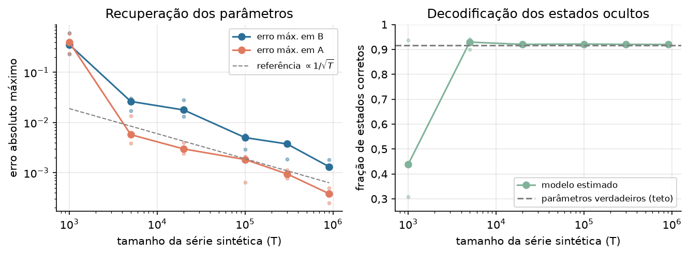

*Figura 1. Esquerda: erro dos parâmetros estimados em função do tamanho da série (escala log-log); a linha tracejada é a taxa teórica 1/√T. Direita: fração de instantes com o estado oculto identificado corretamente; a linha tracejada é o teto obtido com os parâmetros verdadeiros.*

**Interpretação.**

- **O método funciona.** Com a quantidade de dados do treino real, as probabilidades são recuperadas com erro de ~0,1 ponto percentual e as permanências, com erro de ~3%.
- **O erro cai como 1/√T**, a taxa esperada para um estimador de máxima verossimilhança consistente.
- **Há um limite de dados.** Com 1.000 símbolos (~3,5 dias de candles de 5 minutos), o ajuste é inútil. A partir de ~5.000 (~17 dias), já é razoável. Isso importa para quem quiser treinar o HMM em janelas curtas.
- **Mesmo conhecendo o modelo, só dá para acertar o estado em ~92% dos instantes.** Os estados têm emissões que se sobrepõem (um "0" pode vir de qualquer regime), então sempre há ambiguidade. O modelo ajustado atinge esse teto. Pelo Viterbi (caminho mais provável como um todo), o teto é de 89,7%. As probabilidades instante a instante (`predict_proba`) acertam mais estados individuais que o Viterbi, como a teoria prevê.

---

## 5. Teste 3: reinícios e ótimos locais

**O que é.** O Baum-Welch só garante melhorar a cada iteração; não garante chegar ao **melhor ajuste possível** (ótimo global). Dependendo dos parâmetros iniciais sorteados, ele converge para soluções diferentes, os **ótimos locais**. Este teste mede com que frequência isso acontece.

**Por que.** Se cada reinício tem, por exemplo, 10% de chance de chegar à melhor solução, então com 10 reinícios a chance de nenhum chegar é de 0,9¹⁰ ≈ 35%. Ou seja, o modelo relatado no TCC pode ser pior que o possível simplesmente por azar. É o principal risco metodológico do HMM.

**Como foi feito.** Para 2, 3, 4 e 5 estados foram executados 20, 50, 40 e 30 reinícios independentes, respectivamente (seção 2.2), cada um até a convergência (`tolerancia` 1e-8) ou até `max_iter`. Os reinícios cujas log-verossimilhanças finais diferem em menos de 20 nats foram considerados **a mesma solução**. Os pequenos desvios dentro de cada grupo vêm só do critério de parada. Conta-se quantos reinícios chegaram ao grupo do melhor resultado e quantos grupos (soluções distintas) apareceram.

Complementarmente, para saber se os ótimos locais são culpa dos dados reais (modelo inadequado) ou do próprio algoritmo, o mesmo teste foi feito em dados **sintéticos** gerados pelos modelos de 3 e 4 estados (300.000 símbolos, 20 reinícios cada).

**Resultado.**

| Estados | Reinícios | Chegaram ao melhor | Taxa | Soluções distintas | Convergiram antes de `max_iter` | Iterações (mediana) | Tempo por reinício (mediana) |
|---:|---:|---:|---:|---:|---:|---:|---:|
| 2 | 20 | 10 | 50% | 2 | 17 | 1.223 | 1,6 min |
| 3 | 50 | 15 | 30% | 3 | 50 | 1.630 | 2,9 min |
| 4 | 40 | 4 | **10%** | **8** | 35 | 1.883 | 5,0 min |
| 5 | 30 | 6 | 20% | 9 | 28 | 2.268 | 10,9 min |

Em dados sintéticos (o modelo verdadeiro é o melhor HMM real de 3 ou 4 estados; 300.000 símbolos; 20 reinícios):

| Modelo verdadeiro | Chegaram ao melhor | Soluções distintas | Log-veross. do melhor ajuste | Log-veross. dos parâmetros verdadeiros |
|---|---:|---:|---:|---:|
| 3 estados | 9 de 20 (45%) | 2 | −308.494,6 | −308.500,6 |
| 4 estados | 7 de 20 (35%) | 3 | −307.597,1 | −307.606,5 |

O melhor ajuste fica ligeiramente *acima* dos parâmetros verdadeiros, como esperado: o estimador de máxima verossimilhança se adapta um pouco ao ruído da amostra. Ou seja, o melhor reinício encontrou o ótimo global.

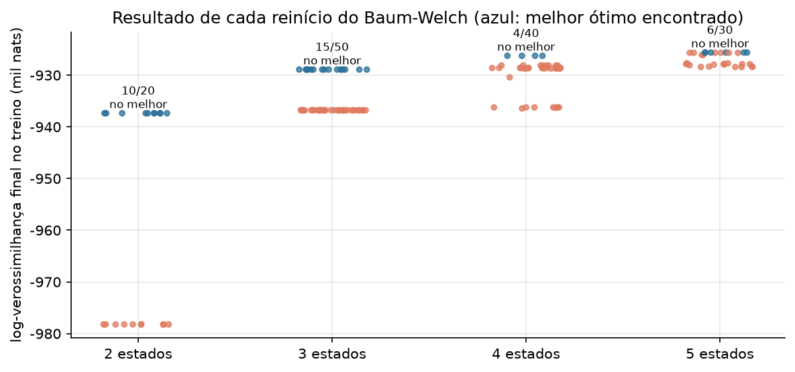

*Figura 2. Log-verossimilhança final de cada reinício. Em azul, os reinícios que chegaram ao melhor ótimo encontrado; em laranja, os que pararam em ótimos locais piores.*

**Interpretação.**

- **As soluções ruins não são variações pequenas: são outras explicações dos dados.** Com 3 estados, 70% dos reinícios caem na solução "direcional", 7.860 nats abaixo da melhor. Nela, dois dos três estados são de curtíssima duração e só representam alta ou queda (ver relatório anterior, seção 8). Com 2 estados, metade dos reinícios para numa solução 40.856 nats pior.
- **Os ótimos locais são do algoritmo, não só dos dados.** Mesmo quando os dados vêm exatamente de um HMM de 3 estados, mais da metade dos reinícios (11 de 20) para numa solução pior. Nos dados reais a taxa é menor (30% com 3 estados, 10% com 4), porque o mercado não é exatamente um HMM e a superfície de otimização fica mais acidentada.
- **A dificuldade cresce com o número de estados.** Com 4 estados, só 4 de 40 reinícios encontraram o melhor ajuste. Com os 6 reinícios do relatório anterior, a chance de nenhum chegar lá seria de 0,9⁶ ≈ 53%.
- **Escolher o modelo pela log-verossimilhança do treino resolve, desde que haja reinícios suficientes.** Os reinícios que chegam ao melhor ótimo no treino também ficam entre os melhores no teste (a menos de 0,0001 nats por símbolo do melhor), em todas as contagens de estados.
- **Recomendação para o texto e para o código:** relatar o número de reinícios e quantos chegaram à melhor solução. Usar pelo menos 20 reinícios com 3 estados e 40 com 4 ou 5. Para acelerar, uma alternativa é inicializar o modelo de *n* estados a partir do de *n − 1*, dividindo um estado em dois.

---

## 6. Teste 4: escolha do número de estados

**O que é.** O número de estados ocultos é um hiperparâmetro: não é aprendido pelo Baum-Welch. Mais estados sempre ajustam melhor o treino (um modelo de *n + 1* estados contém o de *n* como caso particular), então é preciso um critério que penalize a complexidade.

**Por que.** O TCC precisa justificar o número de estados usado.

**Como foi feito.** Para cada número de estados, o melhor dos reinícios da seção 5 foi avaliado por quatro critérios:

- **log-verossimilhança no treino**, por símbolo;
- **AIC** = 2*p* − 2 ln *L* e **BIC** = *p* ln *T* − 2 ln *L*, em que *p* é o número de parâmetros livres (`n_free_parameters`: (*n* − 1) + *n*(*n* − 1) + 2*n*) e *T* = 905.654. Menor é melhor; o BIC penaliza mais a complexidade;
- **log-verossimilhança no teste**, por símbolo: a medida direta de generalização;
- **bootstrap por dias** da diferença no teste entre modelos vizinhos, para saber se ela é distinguível de zero (método na seção 8).

**Resultado.**

| Estados | Parâmetros livres | Log-veross. treino | Por símbolo (treino) | Por símbolo (teste) | AIC | BIC |
|---:|---:|---:|---:|---:|---:|---:|
| 2 | 7 | −937.365,1 | −1,03501 | −1,02525 | 1.874.744,3 | 1.874.826,3 |
| 3 | 14 | −928.914,9 | −1,02568 | −1,01541 | 1.857.857,8 | 1.858.021,8 |
| 4 | 23 | −926.251,2 | −1,02274 | −1,01179 | 1.852.548,3 | 1.852.817,8 |
| 5 | 34 | −925.617,5 | −1,02204 | −1,01156 | **1.851.303,1** | **1.851.701,4** |

| Comparação no teste | Ganho (nats/símbolo) | IC 95% (bootstrap por dias) | Dias em que o maior é melhor |
|---|---:|---|---:|
| 3 estados − 2 estados | 0,0098 | 0,0067 a 0,0134 | 69% |
| 4 estados − 3 estados | 0,0036 | 0,0024 a 0,0049 | 68% |
| 5 estados − 4 estados | 0,0002 | −0,0001 a 0,0005 | 52% |

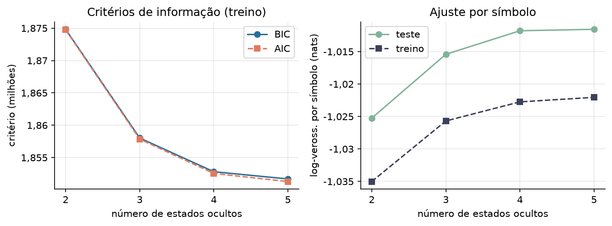

*Figura 3. Esquerda: AIC e BIC no treino (menor é melhor). Direita: log-verossimilhança por símbolo no treino e no teste.*

**Interpretação.**

- **O BIC e o AIC continuam caindo até 5 estados.** Com quase 1 milhão de símbolos, a penalidade do BIC (*p* ln *T* ≈ 13,7 por parâmetro) é pequena perto dos ganhos de centenas de nats, e ele aceita quase qualquer melhoria. Por isso o BIC sozinho não é um bom guia aqui.
- **No teste, o ganho praticamente acaba em 4 estados.** De 4 para 5, a melhora (0,0002 nats por símbolo) não se distingue de zero: o intervalo de confiança inclui o zero e o modelo de 5 só é melhor em 52% dos dias.
- **Correção do relatório anterior.** Lá, o modelo de 5 estados (6 reinícios, `max_iter` 1.000, nenhum convergido) ficava pior que o de 4, o que é impossível no ótimo global. Com 30 reinícios e `max_iter` 4.000, ele fica melhor, como deveria.
- **Sugestão para o TCC:** usar **3 estados** como modelo principal, por ser o mais interpretável (calmo, intermediário, agitado) e já capturar 96% do ganho que o de 4 estados tem sobre o uniforme no teste (0,0832 contra 0,0868 nats por símbolo). Apresentar 4 e 5 como análise de sensibilidade: a interpretação de volatilidade se mantém, e só o de 5 acrescenta algo novo (direção, seção 7).

---

## 7. Teste 5: o que os estados representam

**O que é.** Leitura dos parâmetros aprendidos (`B` diz o que cada estado emite; `A`, como os estados se sucedem) e da distribuição dos estados ao longo da série.

**Por que.** A hipótese secundária do TCC fala em "inferir estados não observáveis (como potenciais regimes de mercado e volatilidade)". Esta seção mostra quais regimes o modelo de fato encontrou.

**Como foi feito.**

- `A` e `B` do melhor ajuste de cada número de estados, com os estados ordenados por P(0).
- **Permanência esperada** de um estado: 1/(1 − `A[i, i]`) candles, multiplicada por 5 minutos.
- **Fração estacionária**: o autovetor de `Aᵀ` associado ao autovalor 1, que dá a fração do tempo em cada estado no longo prazo.
- **Perfil por hora e por dia da semana:** a série inteira (treino e teste) foi passada por `predict_proba`. A probabilidade de cada estado foi então tirada em média por hora do dia (UTC) e por dia da semana.

**Resultado.**

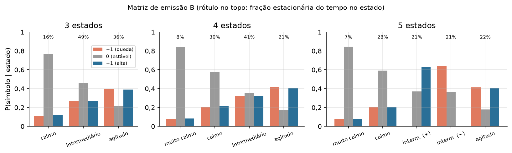

*Figura 4. Matriz de emissão `B` dos modelos de 3, 4 e 5 estados: probabilidade de cada símbolo em cada estado. No topo, a fração do tempo que o modelo passa em cada estado.*

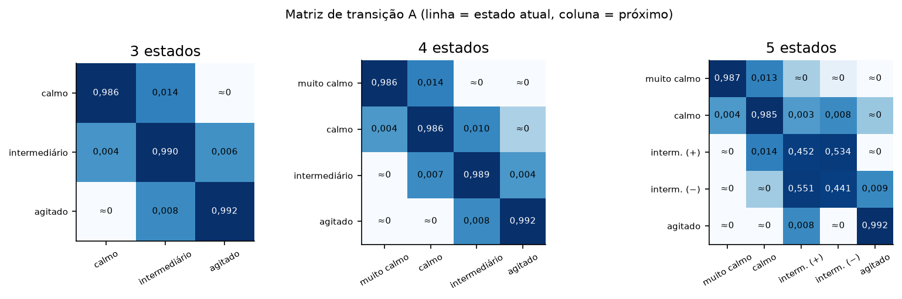

*Figura 5. Matriz de transição `A`. "≈0" indica probabilidade abaixo de 0,0005.*

| Modelo | Estado | P(−1) | P(0) | P(+1) | Permanência | Fração do tempo |
|---|---|---:|---:|---:|---:|---:|
| 3 estados | calmo | 0,114 | 0,767 | 0,119 | 6,1 h | 16,0% |
| | intermediário | 0,267 | 0,462 | 0,271 | 8,0 h | 48,5% |
| | agitado | 0,395 | 0,215 | 0,390 | 10,4 h | 35,5% |
| 4 estados | muito calmo | 0,079 | 0,838 | 0,082 | 6,1 h | 8,1% |
| | calmo | 0,209 | 0,577 | 0,214 | 6,0 h | 30,0% |
| | intermediário | 0,321 | 0,356 | 0,323 | 7,3 h | 40,9% |
| | agitado | 0,416 | 0,175 | 0,409 | 10,4 h | 21,0% |
| 5 estados | muito calmo | 0,076 | 0,845 | 0,079 | 6,3 h | 7,4% |
| | calmo | 0,202 | 0,592 | 0,206 | 5,7 h | 28,0% |
| | intermediário (+) | **0,003** | 0,371 | **0,626** | 0,15 h (1,8 candle) | 21,4% |
| | intermediário (−) | **0,636** | 0,362 | **0,002** | 0,15 h (1,8 candle) | 20,8% |
| | agitado | 0,414 | 0,179 | 0,408 | 10,0 h | 22,4% |

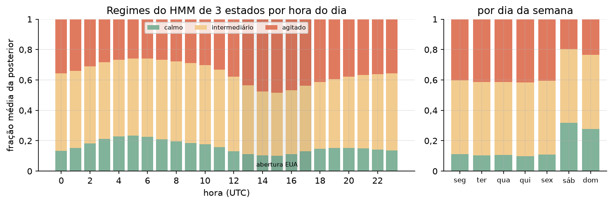

*Figura 6. Probabilidade média de cada regime do HMM de 3 estados por hora do dia (UTC) e por dia da semana, na série inteira.*

**Interpretação.**

- **Regimes de volatilidade.** Nos modelos de 2 a 4 estados, os estados diferem na chance de o candle sair da faixa ±s/3 (de 16% a 82%) e nunca na direção: |P(+1) − P(−1)| < 0,01 em todos. O modelo aprendeu a separar mercado calmo de mercado agitado, mas não mercado de alta de mercado de baixa.
- **Escada.** Em `A`, as transições que pulam um degrau (calmo → agitado, por exemplo) têm probabilidade ≈ 0. A volatilidade sobe e desce de degrau em degrau, e essa estrutura aparece independentemente nos modelos de 3, 4 e 5 estados.
- **Persistência de horas.** Os regimes duram de 6 a 10 horas em média, a escala de um "turno" de negociação.
- **O modelo de 5 estados representa a reversão.** Ele mantém a escada, mas troca o degrau intermediário por um **par de subestados que se alternam**: o "(+)" emite +1 ou 0, o "(−)" emite −1 ou 0, e a cada candle há ~55% de chance de trocar de um para o outro. Juntos, os dois formam um regime intermediário que dura ~7 h. Dentro dele, depois de uma alta, a próxima variação tende a ser uma queda, e vice-versa. É a única forma de um HMM com estados simétricos captar a **autocorrelação negativa do sinal** que existe nos dados (−0,047 na defasagem de 5 minutos, ver relatório anterior, seção 9). Isso explica por que só o modelo de 5 estados tem algum poder direcional (seção 9).
- **O relógio do mercado.** O regime agitado domina das 13 h às 17 h UTC (abertura das bolsas americanas e divulgação de dados econômicos dos EUA). O calmo domina das 3 h às 7 h UTC e no fim de semana, quando sua presença triplica. O modelo nunca recebeu o horário: recuperou essa sazonalidade apenas a partir da sequência de símbolos. A seção 10 testa se o HMM é *só* isso.

---

## 8. Teste 6: desempenho preditivo fora da amostra

**O que é.** Avalia, no período de teste (os últimos 5% da série, nunca vistos no ajuste), quão bem cada modelo prevê o próximo símbolo usando apenas o passado.

**Por que.** É o teste central da hipótese secundária: o HMM tem ganho preditivo que justifique a complexidade?

**Como foi feito.**

- Para cada instante do teste, cada modelo produz uma distribuição de probabilidade para o próximo símbolo. O HMM usa o filtro forward (seção 2.4); os demais usam suas próprias regras (seção 2.3), com o contexto inicial vindo do fim do treino.
- Métricas (definições no Apêndice A):
  - **log-verossimilhança por símbolo**, a métrica principal, que avalia a probabilidade inteira e não só o palpite;
  - **AUC de movimento**: capacidade de ordenar os instantes pela chance de "haver movimento" (símbolo ≠ 0), usando 1 − P(0);
  - **Brier**: erro quadrático entre a distribuição prevista e o resultado;
  - **acurácia** (palpite = símbolo de maior probabilidade);
  - **acerto de direção**: entre os candles que se moveram, fração em que o modelo deu mais probabilidade ao sinal correto.
- **Significância: bootstrap por dias.** Para cada modelo, soma-se a log-verossimilhança de cada um dos 167 dias do teste. Depois, sorteiam-se 167 dias com reposição, 4.000 vezes, e calcula-se a diferença média entre dois modelos em cada sorteio. O intervalo entre os percentis 2,5 e 97,5 é o IC de 95%. Sortear **dias inteiros**, e não candles isolados, preserva a dependência entre candles próximos. Sem isso, o intervalo sairia artificialmente estreito.

**Resultado.**

| Modelo | Log-veross. por símbolo | Ganho sobre o uniforme | AUC movimento | Brier | Acurácia | Acerto de direção |
|---|---:|---:|---:|---:|---:|---:|
| Uniforme | −1,0986 | 0 | 0,500 | 0,667 | 28,6%\* | — † |
| Persistência | −2,7432 | −1,6446 | 0,587 | 1,153 | 40,6% | 48,8% |
| Frequências (iid) | −1,0753 | 0,0233 | 0,500 | 0,651 | 43,8% | 49,1% † |
| Markov ordem 1 | −1,0600 | 0,0386 | 0,587 | 0,639 | 43,8% | 51,2% |
| Hora da semana | −1,0517 | 0,0469 | 0,634 | 0,633 | 45,6% | 50,4% |
| Hora da semana + Markov 1 | −1,0423 | 0,0563 | 0,645 | 0,627 | 45,5% | 51,3% |
| HMM 2 estados | −1,0253 | 0,0734 | 0,690 | 0,614 | 47,2% | 50,6% |
| **HMM 3 estados** | **−1,0154** | **0,0832** | **0,696** | **0,608** | **47,6%** | 50,1% |
| HMM 4 estados | −1,0118 | 0,0868 | 0,697 | 0,606 | 47,7% | 49,8% |
| HMM 5 estados | −1,0116 | 0,0871 | 0,697 | 0,606 | 48,1% | 51,5% |

\* Com a regra argmax, o `Uniform` escolhe sempre −1 (empate entre as três probabilidades).
† Estes modelos dão sempre o mesmo sinal (o uniforme empata; as frequências favorecem +1 por 0,1 ponto percentual). O valor é só a fração de +1 entre os candles que se moveram no teste, e não uma previsão.

| Comparação no teste | Ganho (nats/símbolo) | IC 95% | Dias em que o HMM é melhor |
|---|---:|---|---:|
| HMM 3 − Markov ordem 1 | **0,0446** | 0,0358 a 0,0544 | **91%** |
| HMM 2 − Markov ordem 1 | 0,0347 | 0,0283 a 0,0413 | 80% |
| HMM 3 − Hora da semana + Markov 1 | 0,0269 | 0,0209 a 0,0337 | 72% |

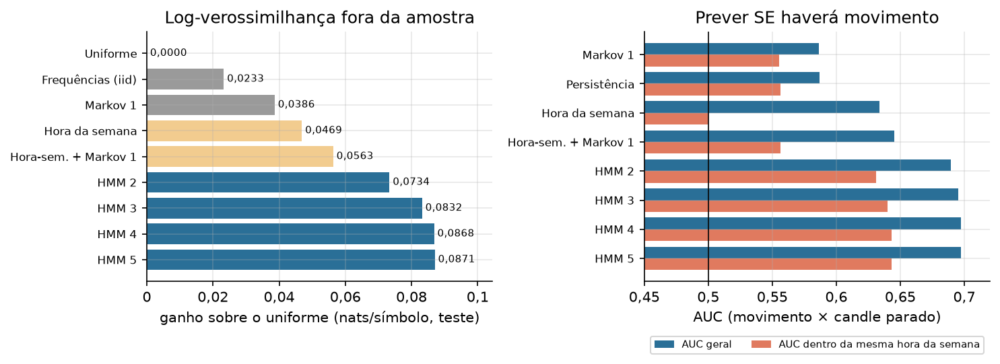

*Figura 7. Esquerda: ganho de log-verossimilhança sobre o uniforme no teste. Direita: AUC de movimento, geral e dentro da mesma hora da semana (seção 10).*

Mês a mês, o HMM de 3 estados supera todos os modelos de referência em cada um dos 6 meses do teste (abril a setembro de 2026), com ganho sobre a Markov de ordem 1 entre 0,026 (maio) e 0,060 (agosto) nats por símbolo.

**Interpretação.**

- **O HMM é claramente o melhor modelo probabilístico entre os testados.** A vantagem sobre a Markov de ordem 1 é grande (0,045 nats por símbolo, o dobro do que as frequências ganham do uniforme), estatisticamente sólida e consistente: o HMM é melhor em 91% dos dias.
- **A vantagem vem de prever *se* haverá movimento** (AUC 0,70 contra 0,59), e não de prever a direção, que fica no acaso (50,1%). A Markov de ordem 1 acerta a direção em 51,2% das vezes porque capta a reversão de curto prazo (depois de uma alta, uma queda é um pouco mais provável). A persistência, que aposta no mesmo sinal, fica abaixo do acaso (48,8%) justamente por causa dessa reversão. O HMM de 3 estados não a capta.
- **A persistência é um modelo de referência muito fraco nesta métrica** (−2,74). Ela põe 98% de probabilidade no símbolo anterior e é punida com força cada vez que erra (60% das vezes). O valor depende diretamente do ε escolhido (0,01). Na acurácia (40,6%) ela fica abaixo de "prever sempre 0" (43,8%).
- **A acurácia diferencia pouco os modelos** (de 43,8% a 48,1%) e é dominada pela classe 0. Para o TCC, a log-verossimilhança e a AUC de movimento contam a história com mais fidelidade.

---

## 9. Teste 7: métricas de classificação do TCC

**O que é.** O texto do TCC (seção "Avaliação de modelos preditivos") define que os modelos serão comparados pela **matriz de confusão** e pela **precisão, *recall* e F1 das classes direcionais (−1 e +1)**, e que um modelo só é superior se tiver vantagem nessas classes. Este teste aplica exatamente esse critério e investiga o que ele mede.

**Por que.** É o critério de sucesso da hipótese. Ele exige transformar a distribuição prevista num **palpite** (−1, 0 ou +1), e a escolha dessa regra afeta muito o resultado.

**Como foi feito.**

- **Duas regras de decisão:**
  1. **argmax:** o palpite é o símbolo de maior probabilidade. É a regra do `src/utils/decision.py`.
  2. **argmax P/prior:** o palpite é o símbolo cuja probabilidade mais **subiu em relação à sua frequência no treino** (P(s)/frequência(s)). Isso compensa o desbalanceamento: o 0 tem 42% de frequência, e com o argmax puro ele ganha quase sempre.
- Para cada modelo e regra: matriz de confusão no teste; precisão = acertos da classe / vezes em que ela foi prevista; *recall* = acertos da classe / vezes em que ela ocorreu; F1 = média harmônica das duas; e o **F1 direcional**, média dos F1 de −1 e +1.
- **Decomposição "quando × para onde".** O palpite de um modelo carrega duas informações: *quando* prever movimento (±1 em vez de 0) e *para onde* (+1 ou −1). Para separá-las, as previsões do HMM com a regra P/prior foram modificadas de três formas, mantendo o "quando" e mudando só o "para onde":
  - **sinal invertido:** troca todo −1 previsto por +1 e vice-versa;
  - **sinal sorteado:** onde o modelo prevê movimento, sorteia o sinal (50/50);
  - **oráculo:** onde o modelo prevê movimento e o candle se moveu, usa o sinal correto (teto do que o "quando" permitiria).

  Se o modelo souber a direção, o original fica bem acima do invertido e do sorteado. Se não souber, os três ficam parecidos.

**Resultado: regra argmax (a do repositório).**

| Modelo | Acurácia | Prec. −1 | *Recall* −1 | F1 −1 | Prec. +1 | *Recall* +1 | F1 +1 | Previsões −1 / 0 / +1 |
|---|---:|---:|---:|---:|---:|---:|---:|---|
| Aleatório (sorteio) | 33,5% | 0,287 | 0,338 | 0,310 | 0,280 | 0,332 | 0,304 | 16.135 / 16.063 / 15.695 |
| Uniforme | 28,6% | 0,286 | 1,000 | **0,444** | — | 0 | 0 | 47.893 / 0 / 0 |
| Persistência | 40,6% | 0,310 | 0,310 | 0,310 | 0,299 | 0,299 | 0,299 | 13.683 / 20.989 / 13.221 |
| Markov ordem 1 | 43,8% | — | 0 | **0** | — | 0 | **0** | 0 / 47.893 / 0 |
| HMM 3 estados | 47,6% | 0,378 | 0,427 | 0,401 | — | 0 | **0** | 15.476 / 32.417 / 0 |
| HMM 4 estados | 47,7% | 0,388 | 0,343 | 0,364 | 0,331 | 0,033 | 0,059 | 12.078 / 34.517 / 1.298 |
| HMM 5 estados | 48,1% | 0,402 | 0,227 | 0,291 | 0,378 | 0,204 | 0,265 | 7.731 / 33.028 / 7.134 |

**Resultado: regra argmax P/prior.**

| Modelo | Acurácia | Prec. −1 | *Recall* −1 | F1 −1 | Prec. +1 | *Recall* +1 | F1 +1 | **F1 direcional** |
|---|---:|---:|---:|---:|---:|---:|---:|---:|
| Aleatório (sorteio) | 33,5% | 0,287 | 0,338 | 0,310 | 0,280 | 0,332 | 0,304 | 0,307 |
| Persistência | 40,6% | 0,310 | 0,310 | 0,310 | 0,299 | 0,299 | 0,299 | 0,305 |
| Markov ordem 1 | 42,2% | 0,341 | 0,330 | 0,335 | 0,326 | 0,337 | 0,332 | 0,333 |
| HMM 2 estados | 45,9% | 0,351 | 0,678 | 0,462 | — | 0 | 0 | 0,231 |
| HMM 3 estados | 47,0% | 0,371 | 0,502 | 0,427 | 0,292 | 0,074 | 0,119 | 0,273 |
| HMM 4 estados | 46,0% | 0,377 | 0,451 | 0,411 | 0,299 | 0,218 | 0,253 | 0,332 |
| HMM 5 estados | 46,1% | 0,369 | 0,393 | 0,381 | 0,338 | 0,316 | 0,327 | **0,354** |

**Resultado: decomposição "quando × para onde"** (F1 direcional, regra P/prior):

| Modelo | Original | Sinal invertido | Sinal sorteado | Oráculo (teto) |
|---|---:|---:|---:|---:|
| HMM 3 estados | 0,273 | 0,273 | 0,323 | 0,638 |
| HMM 4 estados | 0,332 | 0,329 | 0,340 | 0,679 |
| HMM 5 estados | **0,354** | 0,331 | 0,340 | 0,686 |

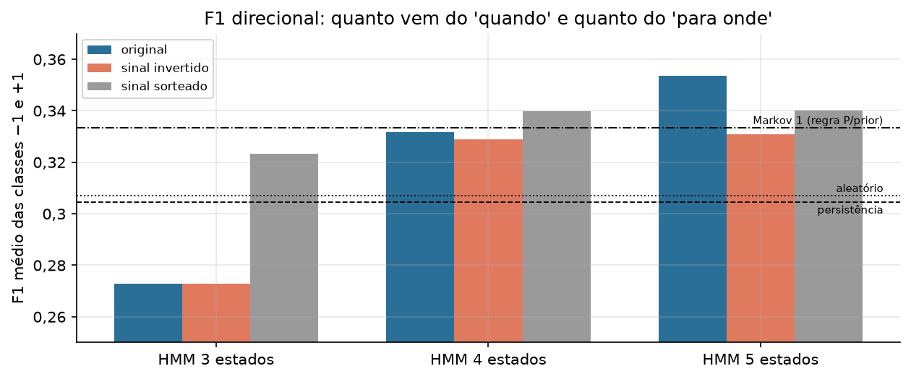

*Figura 8. F1 direcional dos HMMs com o sinal original, invertido e sorteado. As linhas horizontais são os modelos de referência.*

Matriz de confusão do HMM de 3 estados (regra argmax; linhas = real, colunas = previsto):

| Real \ Previsto | −1 | 0 | +1 |
|---|---:|---:|---:|
| −1 | 5.848 | 7.834 | 0 |
| 0 | 4.026 | 16.964 | 0 |
| +1 | 5.602 | 7.619 | 0 |

**Interpretação.**

- **O F1 das classes ±1 depende tanto da regra de decisão quanto do modelo.** Com o argmax do repositório:
  - a Markov de ordem 1 nunca prevê ±1 (a classe 0 é sempre a mais provável) e fica com F1 = 0;
  - o HMM de 3 estados nunca prevê +1: quando o 0 não é o mais provável, −1 ganha de +1 por uma diferença de ~0,004 em `B`, que é ruído de estimação;
  - o `Uniform` prevê sempre −1 por empate e obtém o **maior F1(−1) de todos** (0,444), porque o *recall* é 100%.

  Nenhum desses números diz algo sobre capacidade de prever direção.
- **O F1(−1) alto do HMM é "quando", não "para onde".** A precisão de −1 do HMM de 3 estados (0,378) parece boa perto da frequência de −1 (0,286). Mas nos mesmos instantes, se o palpite fosse +1, a precisão seria de 0,362 (5.602 / 15.476). O modelo sabe escolher os momentos em que *algum* movimento é provável, e só.
- **A decomposição confirma.** Nos HMMs de 3 e 4 estados, inverter o sinal não muda o F1 direcional (0,273 = 0,273; 0,332 ≈ 0,329), e sorteá-lo até melhora (o modelo original concentra os palpites em −1, o que desequilibra as classes). **Esses modelos não têm informação sobre a direção.** O HMM de 5 estados é a exceção: o original (0,354) supera o invertido (0,331) e o sorteado (0,340), graças ao par de subestados da seção 7.
- **Nesse critério, a Markov de ordem 1 (0,333) supera os HMMs de 3 (0,273) e 4 (0,332) estados**, porque capta a reversão de curto prazo. Só o HMM de 5 estados (0,354) fica acima dela.
- **Implicação para a metodologia do TCC.** Se o critério de sucesso for o F1 das classes ±1, é preciso: (a) definir e justificar a regra de decisão (o argmax puro torna o critério degenerado: modelos que nunca preveem uma classe têm F1 = 0 nela); (b) comparar contra o aleatório *com sorteio*, e não contra o `Uniform` com argmax; (c) reportar também a log-verossimilhança e a AUC, que mostram o que o HMM faz bem. Para o HMM, a conclusão honesta é que **ele é um bom modelo do *quando* e não do *para onde***, salvo o de 5 estados, e mesmo nele o ganho direcional é pequeno.

---

## 10. Teste 8: o HMM é só um relógio?

**O que é.** A seção 7 mostrou que os regimes do HMM seguem o horário do mercado. Se o HMM só "descobrisse a hora", um modelo que conhece a hora da semana preveria tão bem quanto ele. Este teste verifica isso.

**Por que.** Separa o que é **sazonalidade** (previsível pelo calendário) do que é **dinâmica própria** (agitação que se propaga de um candle para o seguinte). Se o HMM fosse só um relógio, o texto deveria dizer isso.

**Como foi feito.** Três comparações:

1. **Modelos sazonais** (seção 2.3) contra o HMM, na log-verossimilhança do teste.
2. **AUC estratificada.** Para cada uma das 168 horas da semana, calcula-se a AUC de movimento só entre os candles do teste daquela hora. Depois, faz-se a média ponderada pelo número de candles. Dentro de uma mesma hora, o relógio não tem nada a dizer (AUC = 0,5 por construção). Se o HMM tiver AUC acima de 0,5 aí, ele sabe algo além do relógio.
3. **Combinação (produto de especialistas).** As previsões do HMM e do modelo de hora da semana foram combinadas com P ∝ P_HMM × P_hora / P_frequências, que é a forma de juntar duas fontes de informação supondo que sejam independentes. Se o HMM já tiver toda a sazonalidade, a combinação não melhora nada.

**Resultado.**

| Modelo | Log-veross. (teste) | AUC geral | AUC dentro da mesma hora da semana |
|---|---:|---:|---:|
| Hora da semana | −1,0517 | 0,634 | 0,500 |
| Hora da semana + Markov 1 | −1,0423 | 0,645 | 0,556 |
| HMM 3 estados | −1,0154 | 0,696 | **0,640** |
| HMM 4 estados | −1,0118 | 0,697 | 0,643 |
| HMM 3 × hora da semana (combinação) | −1,0143 | 0,697 | 0,640 |

Ganho da combinação sobre o HMM de 3 estados: 0,0012 nats por símbolo (IC 95%: −0,0005 a 0,0029; melhor em 50% dos dias).

**Interpretação.**

- **O HMM não é só um relógio.** Comparando apenas candles da mesma hora da semana, ele ainda separa movimento de candle parado com AUC de 0,64. Isso é dinâmica própria: a agitação dos últimos candles indica a dos próximos (aglomeração de volatilidade).
- **O HMM já absorve quase toda a sazonalidade.** Juntar a informação do horário ao HMM não traz ganho estatisticamente significativo. Uma explicação provável é que o modelo aprende o efeito do horário indiretamente: como a agitação da abertura americana persiste por horas, o filtro forward a detecta já nos primeiros candles agitados.
- **A sazonalidade explica parte do ganho.** O modelo de hora da semana sozinho já ganha 0,047 nats por símbolo do uniforme, mais da metade do ganho do HMM (0,083). Uma frase justa para o TCC: "parte do poder preditivo do HMM vem da sazonalidade intradiária do mercado, que ele aprende sem receber o horário; a maior parte vem da persistência da volatilidade".

---

## 11. Teste 9: previsão de volatilidade

**O que é.** Se o HMM é um modelo de volatilidade, ele deveria antecipar a agitação real do preço, medida pelo retorno absoluto |r| e não só pelos símbolos. Este teste mede isso para a próxima hora.

**Por que.** Dá uma leitura financeira concreta ao achado da seção 8 e o compara com o jeito mais simples de prever volatilidade, uma média móvel exponencial.

**Como foi feito.**

- **Alvo:** volatilidade realizada da próxima hora, ou seja, a média de |r| dos 12 candles seguintes, calculada a partir do preço de fechamento no teste.
- **Previsores** (todos usam só o passado):
  - **HMM 3 estados:** número esperado de candles com movimento nas próximas 12, `Σ_{h=1..12} [1 − (α_t · Aʰ · B)_0]`;
  - **EWMA do indicador de movimento:** média móvel exponencial de 1{símbolo ≠ 0}, com meia-vida de 1 h ou 6 h. Usa exatamente a mesma informação que o HMM;
  - **EWMA de |r|:** a mesma média, mas do retorno absoluto. Usa o preço contínuo, informação que o HMM não recebe;
  - **hora da semana:** a P(movimento) do modelo sazonal.
- **Medida:** correlação de Spearman (de postos, robusta a valores extremos) e de Pearson entre previsão e alvo, nos 47.881 instantes do teste com 12 candles à frente.

**Resultado.**

| Previsor | Informação usada | Spearman | Pearson |
|---|---|---:|---:|
| Hora da semana | calendário | 0,527 | 0,450 |
| EWMA indicador de movimento (6 h) | símbolos | 0,571 | 0,513 |
| **HMM 3 estados** | símbolos | **0,629** | 0,524 |
| EWMA indicador de movimento (1 h) | símbolos | 0,637 | 0,554 |
| EWMA \|r\| (6 h) | preço contínuo | 0,631 | 0,600 |
| EWMA \|r\| (1 h) | preço contínuo | **0,718** | **0,671** |

**Interpretação.**

- **O HMM antecipa bem a volatilidade da próxima hora** (correlação de postos de 0,63).
- **Mas não melhor que uma média móvel simples** da mesma informação (0,64 com meia-vida de 1 h). Para *prever a volatilidade*, a vantagem do HMM sobre a EWMA é nula; a vantagem dele está em fornecer **probabilidades calibradas** (a calibração foi verificada no relatório anterior, seção 7.1) e **estados interpretáveis**, o que a EWMA não faz.
- **A discretização joga fora informação.** Com o mesmo tipo de média aplicada ao retorno contínuo, a correlação sobe para 0,72. É uma limitação de qualquer modelo que trabalhe com os três símbolos, e não só do HMM. Vale citá-la nas limitações do TCC.

---

## 12. Teste 10: estabilidade no tempo (walk-forward)

**O que é.** No **walk-forward**, o modelo é treinado num trecho do passado e testado no trecho seguinte; depois a janela anda para frente e o processo se repete. Assim se obtém o desempenho em muitos períodos diferentes, e não só nos últimos 5 meses.

**Por que.** O teste principal cobre só abril a setembro de 2026. O mercado de 2018 (pós-bolha), de 2020 (pandemia) e de 2021 (máximas históricas) era bem diferente. Este teste verifica se o ganho do HMM é uma propriedade do período ou do modelo.

**Como foi feito.**

- Janelas trimestrais: o modelo é treinado nos **12 meses anteriores** (~105.000 símbolos) e testado nos **3 meses seguintes** (~26.000 símbolos). A primeira janela de teste começa em 2018-09; a última, em 2026-06. São 32 janelas, sem sobreposição entre os testes.
- Em cada janela: HMM de 3 estados com 8 reinícios (`max_iter` 3.000), frequências (iid) e Markov de ordem 1, todos ajustados só no treino da janela.
- A série usada é a mesma da seção 2.1 (treino e teste concatenados). Cada janela usa apenas símbolos anteriores ao seu teste.

**Resultado.**

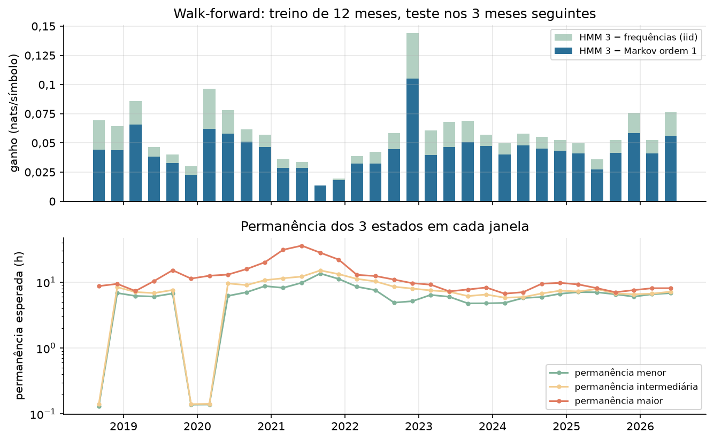

*Figura 9. Acima: ganho do HMM de 3 estados sobre a Markov de ordem 1 (azul) e sobre as frequências (verde claro) no trimestre de teste de cada janela. Abaixo: permanência esperada dos três estados aprendidos em cada janela.*

- O HMM supera a Markov de ordem 1 em **32 de 32 janelas**. O ganho médio é de 0,044 nats por símbolo (mínimo de 0,013, máximo de 0,105).
- O maior ganho (0,105) é no trimestre de dezembro de 2022 a fevereiro de 2023, logo depois do colapso da FTX, cujo choque de volatilidade está no treino dessa janela. Os menores (0,013 e 0,018) são nos trimestres iniciados em setembro e dezembro de 2021, quando o regime agitado aprendido era bem mais longo (22 a 28 h). Mesmo nesses trimestres, o HMM ganhou.
- As permanências ficam na faixa de 5 a 15 h na maior parte do tempo. Nas janelas treinadas entre 2020 e 2021, período de alta forte, o regime agitado chega a durar 30 a 36 h.
- Em 3 janelas (2018-09, 2019-12 e 2020-03), o melhor dos 8 reinícios foi a solução "direcional" (dois estados com permanência de ~0,1 h). Para saber se isso era o comportamento do mercado naqueles períodos ou falta de reinícios, essas 3 janelas foram reajustadas com 24 reinícios. Nas três, apareceu a solução de escada de volatilidade, com log-verossimilhança de treino maior e teste melhor:

| Janela de teste | 8 reinícios (teste) | 24 reinícios (teste) | Permanências com 24 reinícios | Ganho sobre a Markov 1 (8 → 24 reinícios) |
|---|---:|---:|---|---|
| 2018-09 | −0,9732 | −0,9548 | 5,9 / 7,0 / 9,8 h | 0,044 → 0,063 |
| 2019-12 | −1,0738 | −1,0686 | 6,0 / 7,4 / 15,8 h | 0,023 → 0,028 |
| 2020-03 | −0,9775 | −0,9503 | 6,5 / 8,0 / 16,0 h | 0,062 → 0,089 |

Eram ótimos locais, como na seção 5. Os números da figura e do resumo (32 de 32, ganho médio de 0,044) usam os 8 reinícios originais; nas três janelas reavaliadas, mais reinícios aumentaram o ganho.

**Interpretação.**

- **O ganho do HMM não é um acidente do período de teste.** Em 8 anos de mercado, com regimes muito diferentes, o HMM sempre prevê melhor que a Markov de ordem 1.
- **A estrutura aprendida é estável:** regimes de horas, com permanência crescente do calmo ao agitado, em quase todas as janelas.
- **O que muda é a intensidade:** entre 2020 e 2021, a volatilidade ficou "presa" por mais tempo no regime agitado. Isso indica que o modelo é não estacionário no longo prazo e que reajustá-lo periodicamente tem valor.

---

## 13. Teste 11: quantidade de dados (curva de aprendizado)

**O que é.** Mede como o desempenho no teste muda com a quantidade de dados de treino.

**Por que.** Diz se os 905 mil símbolos são necessários ou se uma janela menor e mais recente (que reflete melhor o mercado atual) bastaria. Também complementa a seção 4, agora com dados reais.

**Como foi feito.** HMMs de 2, 3 e 4 estados foram ajustados nos **últimos** N símbolos do treino, com N = 2.000, 10.000, 50.000, 100.000, 300.000 e 905.654 (o treino inteiro; este último vem da seção 6), com 10 reinícios. Todos foram avaliados no mesmo teste. Os mais recentes foram escolhidos porque ficam colados ao teste.

**Resultado.**

Log-verossimilhança por símbolo no teste (o mesmo teste para todos):

| Símbolos de treino | Equivale a | Frequências | Markov ordem 1 | HMM 2 | HMM 3 | HMM 4 | Permanências do HMM 3 (h) |
|---:|---|---:|---:|---:|---:|---:|---|
| 2.000 | 7 dias | −1,0805 | −1,0689 | **−1,0320** | −1,0349 | −1,0344 | 0,1 / 0,2 / 4,3 |
| 10.000 | 5 semanas | −1,0909 | −1,0745 | −1,0342 | −1,0245 | **−1,0233** | 4,3 / 6,2 / 6,3 |
| 50.000 | 6 meses | −1,0752 | −1,0597 | −1,0253 | −1,0151 | **−1,0121** | 6,6 / 8,4 / 8,4 |
| 100.000 | 11,5 meses | −1,0765 | −1,0608 | −1,0253 | −1,0152 | **−1,0120** | 6,4 / 6,8 / 7,8 |
| 300.000 | 2,9 anos | −1,0763 | −1,0606 | −1,0253 | −1,0154 | **−1,0119** | 6,6 / 6,8 / 8,0 |
| 905.654 | 8,6 anos (todo o treino) | −1,0753 | −1,0600 | −1,0253 | −1,0154 | **−1,0118** | 6,1 / 8,0 / 10,4 |

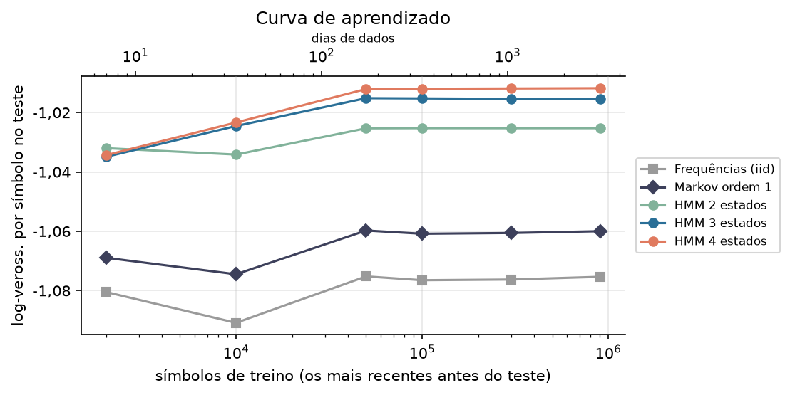

*Figura 10. Log-verossimilhança no teste em função da quantidade de dados de treino (eixo inferior em símbolos, superior em dias).*

Na Markov de ordem 1, com 2.000 e 10.000 símbolos, usou-se +1 em cada contagem para evitar probabilidade zero; com mais dados, a contagem pura, como no `FirstOrder`.

**Interpretação.**

- **Seis meses de dados bastam.** A partir de 50.000 símbolos, o desempenho no teste fica estável: o HMM treinado nos 6 meses mais recentes prevê tão bem quanto o treinado em 8,6 anos (diferença < 0,0005 nats por símbolo). Os anos antigos não acrescentam nem atrapalham.
- **Mesmo com pouquíssimos dados, o HMM ganha da Markov de ordem 1.** Com 10.000 símbolos (5 semanas), o HMM de 3 estados (−1,0245) supera a Markov de ordem 1 treinada nos 8,6 anos (−1,0600).
- **Com 2.000 símbolos, o HMM de 3 estados degenera.** O melhor ajuste é a solução "direcional", com dois estados que duram minutos, e o HMM de 2 estados fica melhor que ele. É o mesmo limite visto nos dados sintéticos (seção 4): abaixo de ~5.000 símbolos, a estimativa não é confiável.
- **Consequência prática.** Para uma versão "ao vivo" (decisão D7 de `docs/discretizacao.md`), retreinar o HMM periodicamente numa janela de 6 a 12 meses deve dar o mesmo desempenho, com ajustes ~10 vezes mais rápidos que no histórico inteiro.

---

## 14. Teste 12: sensibilidade à discretização

**O que é.** Repete o ajuste e a avaliação do HMM com outras formas de transformar o retorno em −1/0/+1.

**Por que.** A discretização é uma escolha da dupla (`docs/discretizacao.md`). Se as conclusões sobre o HMM só valessem para `blocks` com s/3, isso precisaria constar no texto.

**Como foi feito.**

| Variação | O que muda |
|---|---|
| `blocks`, s/4 e s/5 | limiar menor: menos zeros (com s/4, ~33% de cada símbolo; com s/5, o 0 vira o mais raro) |
| `global`, s/3, s/4 e s/5 | média e desvio únicos, estimados só no treino (a definição que está hoje no texto do TCC). Como a volatilidade caiu ao longo dos anos, o teste fica com muito mais zeros que o treino (s/3: 68% no teste contra 51% no treino) |
| `blocks` de 3 meses, s/3 | régua atualizada a cada trimestre, e não a cada mês |

Em cada variação: HMM de 2, 3 e 4 estados (4, 6 e 6 reinícios), frequências e Markov de ordem 1, ajustados no treino e avaliados no teste. Com 6 reinícios não há garantia de chegar ao melhor ajuste possível em cada variação (seção 5). Por isso o objetivo aqui é a **comparação relativa** (o HMM continua à frente? os estados continuam com o mesmo significado?), e não o valor exato de cada ajuste. Como o alfabeto muda de distribuição entre variações, a log-verossimilhança bruta não é comparável entre elas; compara-se o **ganho do HMM sobre a Markov de ordem 1 e sobre as frequências** *dentro* de cada variação.

**Resultado.**

Distribuição dos símbolos em cada variação:

| Variação | Treino (−1 / 0 / +1) | Teste (−1 / 0 / +1) |
|---|---|---|
| blocos 1 mês, s/3 (principal) | 28,8% / 42,3% / 28,9% | 28,6% / 43,8% / 27,6% |
| blocos 1 mês, s/4 | 33,2% / 33,4% / 33,4% | 32,8% / 35,4% / 31,8% |
| blocos 1 mês, s/5 | 36,2% / 27,5% / 36,3% | 35,7% / 29,6% / 34,8% |
| blocos 3 meses, s/3 | 27,5% / 44,8% / 27,6% | 24,7% / 50,7% / 24,6% |
| global, s/3 | 24,4% / 51,0% / 24,6% | 16,2% / **68,0%** / 15,9% |
| global, s/4 | 29,2% / 41,3% / 29,4% | 21,6% / **57,4%** / 20,9% |
| global, s/5 | 32,6% / 34,6% / 32,8% | 25,6% / **49,6%** / 24,8% |

Resultados no teste (log-verossimilhança por símbolo):

| Variação | Frequências | Markov 1 | HMM 2 | HMM 3 | HMM 4 | Ganho HMM 3 − Markov 1 | AUC HMM 3 / Markov 1 | Direção HMM 3 / Markov 1 |
|---|---:|---:|---:|---:|---:|---:|---|---|
| blocos 1 mês, s/3 | −1,0753 | −1,0600 | −1,0253 | −1,0154 | −1,0118 | **0,045** | 0,695 / 0,587 | 50,1% / 51,2% |
| blocos 1 mês, s/4 | −1,0986 | −1,0866 | −1,0559 | −1,0468 | −1,0468 | **0,040** | 0,688 / 0,576 | 50,1% / 51,0% |
| blocos 1 mês, s/5 | −1,0964 | −1,0867 | −1,0595 | −1,0515 | −1,0515 | **0,035** | 0,682 / 0,567 | 50,5% / 51,2% |
| blocos 3 meses, s/3 | −1,0419 | −1,0259 | −0,9894 | −0,9812 | −0,9780 | **0,045** | 0,687 / 0,583 | 50,2% / 51,3% |
| global, s/3 | −0,9081 | −0,8707 | −0,8096 | −0,7948 | −0,7891 | **0,076** | 0,710 / 0,593 | 49,8% / 51,0% |
| global, s/4 | −1,0294 | −0,9976 | −0,9397 | −0,9242 | −0,9192 | **0,073** | 0,694 / 0,587 | 49,6% / 51,6% |
| global, s/5 | −1,0897 | −1,0626 | −1,0094 | −0,9945 | −0,9944 | **0,068** | 0,683 / 0,580 | 49,5% / 51,8% |

Estrutura do HMM de 3 estados em cada variação:

| Variação | P(0) nos 3 estados | Maior \|P(+1) − P(−1)\| | Permanências (h) |
|---|---|---:|---|
| blocos 1 mês, s/3 | 0,768 / 0,462 / 0,215 | 0,005 | 6,1 / 8,0 / 10,4 |
| blocos 1 mês, s/4 | 0,679 / 0,379 / 0,171 | 0,008 | 6,2 / 9,4 / 12,7 |
| blocos 1 mês, s/5 | 0,594 / 0,313 / 0,139 | 0,010 | 6,9 / 11,0 / 15,4 |
| blocos 3 meses, s/3 | 0,807 / 0,478 / 0,216 | 0,004 | 6,8 / 7,6 / 10,5 |
| global, s/3 | 0,861 / 0,533 / 0,246 | 0,004 | 6,1 / 6,6 / 9,5 |
| global, s/4 | 0,786 / 0,443 / 0,196 | 0,004 | 6,0 / 7,8 / 11,7 |
| global, s/5 | 0,719 / 0,382 / 0,166 | 0,004 | 6,1 / 8,9 / 14,1 |

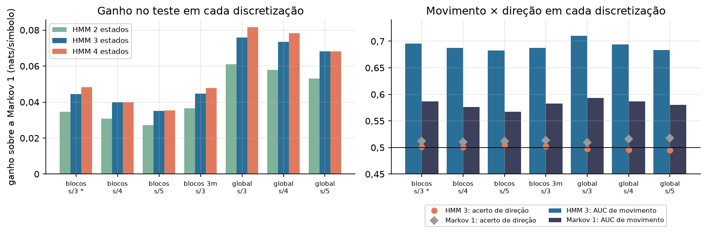

*Figura 11. Esquerda: ganho do HMM sobre a Markov de ordem 1 no teste, em cada discretização (\* = a principal). Direita: AUC de movimento (barras) e acerto de direção (pontos) do HMM de 3 estados e da Markov de ordem 1.*

**Interpretação.**

- **As conclusões não dependem da discretização.** Nas 7 variações, o HMM de 3 estados supera a Markov de ordem 1 (0,035 a 0,076 nats por símbolo), separa movimento de candle parado muito melhor (AUC de 0,68 a 0,71, contra 0,57 a 0,59) e não acerta a direção (49,5% a 50,5%, contra 51,0% a 51,8% da Markov de ordem 1).
- **Os estados são sempre uma escada de volatilidade simétrica** com 3 estados (assimetria ≤ 0,01), com permanências de 6 a 15 h.
- **Limiar menor, menos zeros, regimes mais longos.** Com s/5, há menos símbolos 0 para distinguir os regimes, e o modelo os "enxerga" com menos nitidez: o ganho cai de 0,045 para 0,035, e o regime agitado dura mais (15 h).
- **Com s/4 e s/5, o modelo de 4 estados já se comporta como o de 5 estados com s/3.** O quarto estado não vira mais um degrau de volatilidade, e sim um par de subestados direcionais de ~2 candles (P(−1) ≈ 0,62 com P(+1) ≈ 0, e o inverso). Por isso, nessas variações, o HMM de 4 estados empata com o de 3 na log-verossimilhança e é o único HMM com direção acima de 51% (51,1%, 51,2% e 51,4%), no mesmo nível da Markov de ordem 1. Quanto menos zeros, mais a reversão de sinal "vale" para o modelo.
- **O modo `global` é o mais favorável ao HMM em termos relativos** (ganho de ~0,07). Isso acontece porque, com a régua do treino, o teste de 2026 tem muito mais zeros (68% em s/3), e a diferença entre momentos calmos e agitados fica mais marcada. O valor absoluto da log-verossimilhança (−0,79) **não** é comparável com o do modo `blocks` (−1,02): ele é melhor só porque os símbolos do teste ficaram mais previsíveis (mais zeros), e não porque o modelo é melhor.
- **O tamanho do bloco (1 ou 3 meses) não muda nada** de relevante: ganho idêntico (0,045) e a mesma estrutura.
- **Número de estados pelo BIC:** em todas as variações, entre 2, 3 e 4 estados, o BIC escolhe 4. É o mesmo padrão da seção 6.

---

## 15. Teste 13: custo computacional

**O que é.** Mede o tempo do ajuste e onde ele é gasto, e compara com o `hmmlearn` e com a Markov de ordem 1.

**Por que.** A hipótese secundária pergunta se o ganho do HMM "justifica sua maior complexidade computacional".

**Como foi feito.** Com a máquina ociosa (nenhum outro ajuste rodando):

1. **Tempo de cada kernel** (`_forward`, `_backward`, `_acumular_paralelo`, `_m_step`, `_viterbi`) na série de treino inteira (T = 905.654), para 2, 3, 4, 6 e 8 estados, com parâmetros sorteados. Cada medida é a mediana de 5 execuções, depois de uma execução de aquecimento (que compila o código com o JIT).
2. **Paralelização:** o passo E (`_acumular_paralelo`) medido com 1, 2, 4, 8 e 12 threads (`numba.set_num_threads`).
3. **Escala com T:** tempo por iteração do `fit` com 10.000, 100.000, 300.000 e 905.654 símbolos (3 estados).
4. **Comparação com o `hmmlearn`** (`CategoricalHMM`, implementações `scaling` e `log`): tempo por iteração de 10 iterações de `fit`, nos mesmos dados e com os mesmos parâmetros iniciais.
5. **Comparação com a Markov de ordem 1:** tempo do `FirstOrder.fit` no treino inteiro.

**Resultado.**

Tempo por iteração do Baum-Welch (T = 905.654, em milissegundos):

| Estados | forward | backward | passo E (1 thread) | passo E (12 threads) | passo M | **iteração (1 thread)** | **iteração (12 threads)** | Viterbi (uma vez) |
|---:|---:|---:|---:|---:|---:|---:|---:|---:|
| 2 | 9,6 | 5,6 | 9,1 | 7,8 | < 0,1 | 24,3 | 23,0 | 16,8 |
| 3 | 13,7 | 8,9 | 15,2 | 10,9 | < 0,1 | 37,8 | 33,5 | 23,7 |
| 4 | 17,5 | 13,5 | 16,2 | 8,8 | < 0,1 | 47,2 | 39,8 | 31,0 |
| 6 | 39,4 | 34,0 | 28,9 | 13,1 | < 0,1 | 102,2 | 86,4 | 55,6 |
| 8 | 41,2 | 36,0 | 21,7 | 12,1 | < 0,1 | 98,8 | 89,3 | 74,6 |

Escala com o tamanho da série (3 estados): 0,6 ms por iteração com 10 mil símbolos, 4,0 ms com 100 mil, 11,5 ms com 300 mil e 35,8 ms com 905 mil. É linear, cerca de **40 ns por símbolo por iteração**.

Comparação com o `hmmlearn` (ms por iteração, T = 905.654):

| Estados | `hmmlearn` (scaling) | `hmmlearn` (log) | **`hmm_numba`** | Aceleração sobre o scaling |
|---:|---:|---:|---:|---:|
| 2 | 79,3 | 297,5 | **26,7** | 3,0× |
| 3 | 96,4 | 426,5 | **35,6** | 2,7× |
| 4 | 125,0 | 593,6 | **46,3** | 2,7× |

Custo de um ajuste completo e comparação com a Markov de ordem 1:

| Modelo | Tempo de ajuste no treino inteiro |
|---|---|
| Markov ordem 1 (`FirstOrder.fit`) | **0,013 s** |
| HMM 2 estados, 1 reinício (mediana) | 1,6 min |
| HMM 3 estados, 1 reinício (mediana) | 2,9 min |
| HMM 4 estados, 1 reinício (mediana) | 5,0 min |
| HMM 5 estados, 1 reinício (mediana) | 10,9 min |
| HMM 3 estados, 20 reinícios, 7 processos em paralelo | ~10 min |

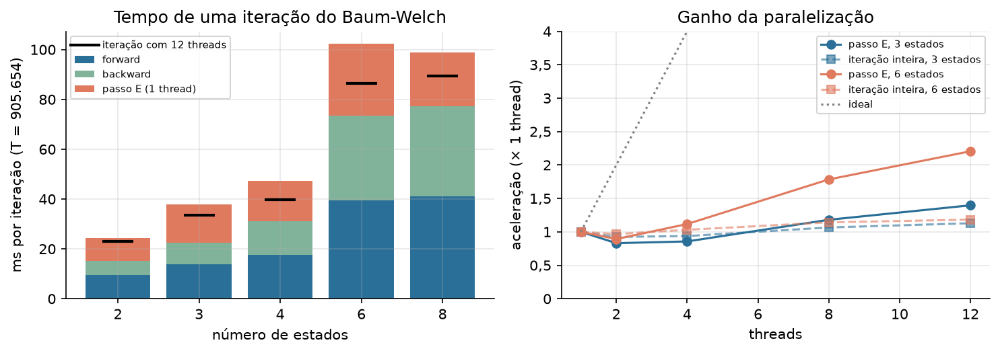

*Figura 12. Esquerda: decomposição do tempo de uma iteração (barras empilhadas, 1 thread) e o tempo com 12 threads (traço). Direita: aceleração do passo E e da iteração inteira em função do número de threads.*

Os tempos de ajuste por reinício foram medidos durante as baterias, com 7 processos simultâneos. Estão, portanto, ~1,5× acima do que um processo sozinho levaria.

**Interpretação.**

- **A implementação em Numba é rápida:** 2,7 a 3× mais rápida que o `hmmlearn` com a mesma técnica (escalonamento), e 12× mais rápida que a versão em log do `hmmlearn`.
- **A paralelização por threads quase não ajuda.** O passo E, a única parte paralela, ganha no máximo 1,4× (3 estados) a 2,2× (6 estados) com 12 threads. A iteração inteira ganha só 1,1× a 1,2×, porque o forward e o backward são **sequenciais por natureza** (cada instante depende do anterior) e ocupam de 60% a 72% do tempo. É a lei de Amdahl: a parte que não se paraleliza limita o ganho total. O processador do teste também tem só 2 núcleos de desempenho e 8 de eficiência, o que reduz o ganho dos threads extras.
- **Por isso, a forma eficiente de usar vários núcleos é rodar os reinícios em paralelo** (um processo por reinício), como foi feito neste relatório: 7 reinícios ao mesmo tempo, cada um a ~1 thread.
- **Custo × benefício (hipótese secundária).** O ajuste do HMM custa cerca de 10 mil vezes mais que o da Markov de ordem 1 (minutos contra centésimos de segundo) e precisa de vários reinícios. Em troca, entrega 0,045 nats por símbolo a mais no teste, a separação entre momentos calmos e agitados (AUC 0,70 contra 0,59) e regimes interpretáveis. Em valores absolutos o custo é pequeno: um modelo completo leva minutos num notebook, e a previsão de um novo candle (um passo do filtro) custa microssegundos. **O custo computacional não é impedimento.** O que limita o HMM é não prever direção.
- **Observação:** os tempos com 6 e 8 estados ficaram parecidos, quando o esperado seria crescer com *n*². É provável que isso seja ruído de medição causado pela troca do processo entre núcleos de desempenho e de eficiência. Os valores de 2 a 4 estados, os usados no TCC, são consistentes entre si.

---

## 16. Conclusões à luz da hipótese do TCC

A hipótese secundária do TCC pergunta se o HMM, por inferir estados não observáveis (regimes de mercado e volatilidade), oferece um ganho preditivo que justifique sua maior complexidade computacional em comparação com as cadeias de Markov. Com os modelos de referência considerados aqui (aleatório, persistência, frequências e Markov de ordem 1), os testes respondem em três partes:

1. **Sim, o HMM infere regimes, e eles têm significado.** Os estados encontrados são regimes de volatilidade (calmo, intermediário e agitado), organizados em escada, que duram horas e seguem o relógio do mercado (abertura americana, fim de semana) sem que o modelo receba o horário. A escada se repete com 2 a 5 estados, em todas as discretizações e nas janelas de 2018 a 2026 (com reinícios suficientes; seção 12). A implementação foi validada contra força bruta e contra o `hmmlearn`, e recupera corretamente um modelo conhecido em dados simulados.

2. **Sim, há ganho preditivo, mas no *quando* e não no *para onde*.** Na log-verossimilhança fora da amostra, o HMM de 3 estados ganha 0,045 nats por símbolo da Markov de ordem 1 (IC 95%: 0,036 a 0,054), é melhor em 91% dos dias do teste e em todas as 32 janelas do walk-forward. Ele separa candles com e sem movimento com AUC de 0,70, contra 0,59. **Na direção, porém, o HMM de 3 ou 4 estados não tem informação:** o acerto de direção é de 50%, e o F1 das classes ±1 vem inteiramente de saber quando haverá movimento. Pelo critério de sucesso definido no texto (F1 das classes direcionais), o HMM de 3 estados (0,273) e o de 4 (0,332) **não superam** a Markov de ordem 1 (0,333). Só o HMM de 5 estados (0,354) a supera, e por margem pequena.

3. **O custo é alto em termos relativos, mas pequeno em termos absolutos.** O ajuste custa ~10 mil vezes mais que o da Markov de ordem 1 e exige vários reinícios. Ainda assim, é questão de minutos num notebook. O custo que de fato pesa é metodológico: sem reinícios suficientes, o modelo relatado pode ser um ótimo local bem pior (seção 5).

**Frase-resumo sugerida:** "O HMM mostrou-se um modelo eficaz da *volatilidade* intradiária do Bitcoin: identifica regimes de agitação interpretáveis e estáveis no tempo e prevê melhor que os modelos de referência *se* haverá movimento, com custo computacional aceitável. Não apresentou, no entanto, capacidade de prever a *direção* do próximo movimento além do acaso, exceto, marginalmente, na configuração de 5 estados, que dedica estados à reversão de curto prazo."

A comparação com as cadeias de Markov de ordem alta (modelo de Raftery/MTD) fica para o relatório conjunto da dupla.

## 17. Limitações

Do modelo:

1. **Estados simétricos não representam direção.** Com 2 a 4 estados, cada estado emite +1 e −1 com a mesma chance. O HMM só capta a reversão de curto prazo quando tem estados de sobra para "gastar" com ela (5 estados, seção 7).
2. **Memória curta.** A matriz `A` faz o modelo "esquecer" o regime em cerca de um dia. A memória real da volatilidade é mais longa (o relatório anterior mediu autocorrelação de 0,10 na defasagem de 1 dia, contra ~0 no modelo).
3. **Homogêneo no tempo.** `A` não depende do horário. A sazonalidade é aprendida só indiretamente (seção 10), e o modelo não reproduz o ciclo de 24 h.
4. **Não estacionário no longo prazo.** A duração dos regimes muda de um ano para outro (seção 12). Um único modelo para 2017–2026 é uma média desses períodos.
5. **Trabalha com símbolos.** A discretização descarta a magnitude do retorno, e um previsor simples sobre o retorno contínuo antecipa melhor a volatilidade (seção 11).

Do método de avaliação:

6. **Um único período de teste** no experimento principal (167 dias de 2026). O walk-forward (seção 12) mitiga isso, mas usa só 3 estados e 8 reinícios por janela.
7. **Ótimos locais.** Mesmo com 30 a 50 reinícios, não há garantia de que o melhor ajuste encontrado seja o ótimo global; há apenas a evidência de que vários reinícios independentes chegaram a ele.
8. **Lacunas.** O treino concatena 35 trechos contínuos como se fossem uma sequência só (pendência D6). O relatório anterior mostrou que o efeito é desprezível para o HMM (1,4·10⁻⁴ nats por símbolo).
9. **Sem custos de transação.** Nenhum resultado de direção aqui (51% a 52%) deve ser lido como estratégia lucrativa: spread e taxas não foram considerados.
10. **Comparação incompleta.** Ficou de fora a comparação com as cadeias de Markov de ordem alta (modelo de Raftery/MTD), que será feita no relatório conjunto.

## 18. Recomendações

Nenhuma delas foi aplicada ao código; ficam como sugestão.

**Para os experimentos do TCC**

1. **Reinícios:** pelo menos 20 com 3 estados e 40 com 4 ou 5. Relatar no texto quantos chegaram à melhor solução (seção 5).
2. **`max_iter` de 3.000 a 4.000.** O padrão de 1.000 interrompe muitos reinícios antes da convergência (a mediana com 5 estados é de 2.268 iterações).
3. **Fixar `n_blocos`** (`--blocks` no `hmm_training.py`) para que os números do texto sejam reproduzíveis em outra máquina (seção 3).
4. **Ordenar os estados por P(0) ao salvar**, para os rótulos serem estáveis entre execuções.
5. **Partir o filtro do teste da distribuição estacionária**, e não do `π_` aprendido.
6. **Definir a regra de decisão** antes de comparar F1, e usar o aleatório *com sorteio* como modelo de referência (seção 9).
7. **Reportar a log-verossimilhança e a AUC** junto com o F1, e um intervalo de confiança por bootstrap por dias para as diferenças entre modelos (seção 8).

**Para o código (melhorias possíveis)**

8. **Inicialização a partir do modelo menor**: ajustar *n* estados partindo do melhor de *n − 1*, com um estado dividido em dois. Tende a reduzir os reinícios necessários.
9. **Reinícios em paralelo por processo.** O ganho de paralelizar o passo E com threads é pequeno (seção 15). Rodar reinícios independentes em processos aproveita melhor os núcleos.
10. **Guardar todos os reinícios no JSON** de `hmm_training.py` com seus parâmetros, não só a log-verossimilhança, para permitir análises como a da seção 5.

## 19. Onde cada resultado entra na monografia

Sugestão de onde cada parte pode entrar em `tcc_escrita/tcc2_escrita/tcc2.tex`:

| Seção do TCC | O que usar deste relatório |
|---|---|
| Introdução › Hipótese (hipótese secundária) | A resposta está nas seções 8, 9 e 15: ganho preditivo claro na log-verossimilhança e na AUC de movimento, a um custo de minutos de CPU; nenhum ganho de direção com 3 ou 4 estados |
| Revisão › Modelos Ocultos de Markov (Baum-Welch) | Acrescentar que o EM converge para ótimos locais e que, por isso, se usam vários reinícios (seção 5, Figura 2) e a normalização de Rabiner contra *underflow* (seção 3) |
| Revisão › Avaliação de modelos preditivos | Acrescentar a log-verossimilhança fora da amostra e a AUC como métricas probabilísticas, e discutir a dependência do F1 em relação à regra de decisão (seção 9) |
| Desenvolvimento › Detalhes da implementação | Kernels em Numba, normalização por fator de escala, paralelização do passo E (seção 15), validação contra força bruta e contra o `hmmlearn` (seção 3) |
| Desenvolvimento › Experimentos e cenário de testes | Divisão treino/teste, número de reinícios e critérios (seções 2 e 5), walk-forward (seção 12), curva de aprendizado (seção 13), sensibilidade à discretização (seção 14) |
| Desenvolvimento › Resultados e análises | Seleção de estados (6), interpretação dos regimes (7, Figuras 4 a 6), comparação com os modelos de referência (8), métricas do TCC (9), sazonalidade (10), volatilidade (11), estabilidade (12) |
| Conclusão › Limitações e trabalhos futuros | Seção 17 |

**Pontos do texto atual que divergem do que o código faz** (notados durante os testes; não alterei o `.tex`):

- O pipeline ("Pipeline da solução") fala em "BTC/USD" e "aproximadamente 920 mil registros". O par é **BTC/USDT** e o snapshot tem **957.853** candles (953.547 símbolos válidos no modo `blocks`).
- O texto diz que "valores discrepantes (*outliers*) ... também foram descartados". O código (`src/preprocess/discretize.py`) **não** remove *outliers*: descarta só os retornos que atravessam lacunas.
- O texto descreve a discretização com média e desvio únicos (o modo `global`). Os experimentos do HMM usam o modo `blocks` (decisão D3 de `docs/discretizacao.md`). A seção 14 mostra o efeito dessa escolha no HMM.
- A "Visão geral da solução" apresenta o HMM como "modelo de referência" e as métricas como acurácia, precisão, *recall*, F1 e matriz de confusão. Pela seção 9, para o HMM vale incluir a log-verossimilhança e a AUC; caso contrário, o que o modelo faz bem fica invisível.

---

## Apêndice A: glossário

| Termo | Definição | Como ler |
|---|---|---|
| **Log-verossimilhança** (ln *L*) | Soma, sobre a sequência, do logaritmo natural da probabilidade que o modelo deu ao símbolo que realmente aconteceu: Σ ln P(y_t \| passado). Para o HMM, é o `ll` que `_forward` devolve | Mais perto de zero é melhor. Dividida pelo número de símbolos dá a média **por símbolo**, comparável entre treino e teste |
| **nat** | Unidade de informação com logaritmo natural (1 nat ≈ 1,44 bit) | Diferença de 0,01 nat por símbolo = o modelo melhor dá, em média, ~1% mais probabilidade ao que acontece |
| **Ótimo local / global** | O Baum-Welch sobe a log-verossimilhança até não conseguir mais melhorar. O ponto onde para pode não ser o mais alto possível (global), e sim um "pico" menor (local) | Por isso se fazem vários reinícios |
| **Reinício** | Um ajuste completo do Baum-Welch a partir de parâmetros iniciais sorteados | Fica o de maior log-verossimilhança no treino |
| **Permanência esperada** | Tempo médio que o modelo fica num estado antes de sair: 1/(1 − A[i,i]) candles | Em horas: × 5/60 |
| **Distribuição estacionária** | Fração do tempo em cada estado no longo prazo; autovetor de Aᵀ com autovalor 1 | Usada como ponto de partida do filtro no teste |
| **Filtro forward** | Cálculo de P(estado em *t* \| observações até *t*), usando só o passado | É o que permite prever sem olhar o futuro |
| **Posterior / `predict_proba`** | P(estado em *t* \| sequência inteira), usando passado e futuro | Serve para interpretar a série, não para prever |
| **Viterbi / `predict`** | O caminho de estados mais provável como um todo | Suaviza mudanças curtas de regime |
| **AIC** | 2*p* − 2 ln *L*, com *p* = número de parâmetros livres | Menor é melhor; penaliza complexidade de leve |
| **BIC** | *p* ln *T* − 2 ln *L* | Menor é melhor; penaliza mais que o AIC, mas pouco quando *T* é enorme |
| **Parâmetros livres** | Número de probabilidades que o modelo escolhe livremente (cada linha soma 1, então tem uma a menos): HMM = (*n* − 1) + *n*(*n* − 1) + 2*n* | 2 estados: 7; 3: 14; 4: 23; 5: 34. Markov de ordem 1: 6 |
| **AUC de movimento** | Probabilidade de que, sorteando um candle que se moveu (±1) e um que ficou parado (0), o modelo tenha dado mais chance de movimento ao primeiro. Calculada pelo método dos postos (Mann-Whitney) | 0,5 = acaso; 1 = separa perfeitamente |
| **AUC estratificada** | A mesma AUC, calculada separadamente dentro de cada hora da semana e depois promediada (pesos = número de candles) | Remove o que é explicável só pelo horário |
| **Brier** | Σ_k (P_k − 1{y = k})², média no teste | Menor é melhor; uniforme = 0,667 |
| **Acurácia** | Fração de palpites certos | Dominada pela classe 0 neste problema |
| **Precisão (classe *c*)** | Acertos de *c* / vezes em que *c* foi prevista | "Quando o modelo diz *c*, quanto acerta" |
| ***Recall* (classe *c*)** | Acertos de *c* / vezes em que *c* ocorreu | "Dos *c* reais, quantos o modelo pegou" |
| **F1** | Média harmônica de precisão e *recall*: 2PR/(P + R) | 0 se a classe nunca é prevista |
| **F1 direcional** | Média do F1 das classes −1 e +1 | Critério do TCC |
| **Regra de decisão argmax** | Palpite = símbolo de maior probabilidade prevista | É a de `src/utils/decision.py` |
| **Regra argmax P/prior** | Palpite = símbolo com maior razão P(prevista)/frequência no treino | Compensa o desbalanceamento das classes |
| **Acerto de direção** | Entre os candles que se moveram, fração em que P(sinal correto) > P(sinal oposto) | 50% = acaso |
| **Bootstrap por blocos (dias)** | Sorteio com reposição de dias inteiros do teste, recalculando a estatística a cada sorteio; o intervalo entre os percentis 2,5 e 97,5 de 4.000 sorteios é o IC de 95% | Se o IC não contém o zero, a diferença é significativa |
| **Walk-forward** | Treinar numa janela do passado, testar na seguinte e repetir andando a janela | Mede o desempenho em vários períodos |
| **EWMA** | Média móvel exponencial: s_t = a·x_t + (1 − a)·s_{t−1}, com a = 1 − 0,5^(1/meia-vida) | Previsor simples de volatilidade |
| **Correlação de Spearman** | Correlação entre os postos (ordens) de duas variáveis | Robusta a valores extremos |
| **Produto de especialistas** | Combinação P ∝ P₁ × P₂ / P_base de duas previsões, supondo que tragam informações independentes | Usada na seção 10 |

## Apêndice B: reprodução

Tudo o que foi usado está em `relatorios/testes_hmm_numba/`:

| Pasta | Conteúdo |
|---|---|
| `relatorio_testes_hmm_numba.md` | este relatório |
| `figuras/` | as 12 figuras (PNG, 150 dpi) |
| `dados/` | resultados brutos e resumos: todos os reinícios (`pool_*.pkl`, com parâmetros, log-verossimilhança e iterações), resumos (`*_summary.pkl`) e métricas (`*.json`) |
| `scripts/` | os scripts que geraram tudo |

**Requisitos além do `requirements.txt`:** `matplotlib` (figuras) e `hmmlearn` (só para `validate.py` e `bench.py`).

**Ordem de execução** (de dentro de `relatorios/testes_hmm_numba/scripts/`, com o snapshot em `snapshot/`):

```bash
# modelo de Markov de ordem 1 na versão do commit usado (o arquivo no disco estava em edição)
git show e1adb76:src/models/naive_models/first_order.py > first_order_head.py

python3 validate.py                          # seções 3 e 4  -> dados/validacao.json
python3 fitpool.py states 7 cfg_states.json  # seção 5 e 6   -> dados/pool_states.pkl (~11 h de CPU)
python3 states_summary.py                    # seções 5 a 7  -> dados/states_summary.pkl
python3 synth_multi.py 4                     # seção 5       -> dados/synth_multi.pkl
python3 season.py 2 3 4 5                    # seções 8 a 11 -> dados/sazonal_preditivo.json
python3 flip.py                              # seção 9       -> dados/flip.json
python3 walkforward.py 4                     # seção 12      -> dados/walkforward.json
python3 wf_recheck.py 4                      # seção 12      -> dados/wf_recheck.pkl
python3 fitpool.py lc 4 cfg_lc.json          # seção 13      -> dados/pool_lc.pkl
python3 lc_summary.py                        # seção 13      -> dados/curva_aprendizado.json
python3 fitpool.py disc 7 cfg_disc.json      # seção 14      -> dados/pool_disc.pkl
python3 disc_summary.py                      # seção 14      -> dados/disc_summary.pkl
python3 bench.py                             # seção 15 (com a máquina ociosa) -> dados/bench.json
python3 figs.py                              # todas as figuras -> figuras/
```

- `fitpool.py` executa cada reinício como um processo separado, com `NUMBA_NUM_THREADS=1`. O segundo argumento é o número de processos simultâneos; o terceiro, o arquivo de configuração (número de estados, discretização, reinícios e `max_iter` de cada bateria). Se for interrompido, retoma de onde parou.
- `common.py` guarda a discretização de cada variação em `dados/cache/` (~27 MB cada; regenerável, não precisa ser versionada).
- As sementes estão fixas em todos os scripts, e os resultados são determinísticos com `n_blocos = 1`. Os tempos (seção 15) dependem da máquina.
- Duas diferenças entre o que foi executado e os scripts desta pasta, sem efeito nos números relatados: (1) a bateria de estados também iniciou ajustes de 6 e 7 estados, interrompidos a pedido e excluídos de `cfg_states.json` e de `pool_states.pkl`; (2) o walk-forward executado calculou internamente outras referências, que foram apagadas do resultado. O `walkforward.py` desta pasta calcula só as que constam no relatório.
